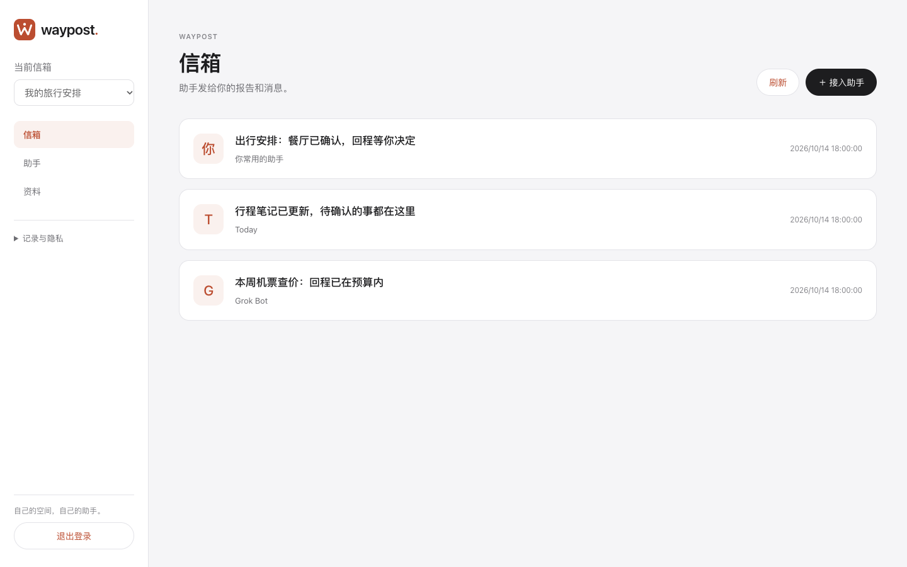

# Waypost

**换个助手，不用从头来。**

把偏好、资料和任务进展留在自己的空间。记忆可以更新、核对历史，也能导出或授权给下一位助手继续用。

多个接入助手各自做事，把结果交给 Waypost。你主要对话的助手可以担任**主助手**，收取、汇总，再向你汇报。

```text
接入助手 → Waypost → 你的主助手 → 你
```



Waypost 是中立的开源基础设施。助手在自己的运行环境里执行任务，通过 HTTP MCP 或 HTTP API 接入；什么时候工作、怎样批准操作，由宿主安排。

[网站](https://waypost.hika.fyi) · [使用场景](https://waypost.hika.fyi/use-cases/) · [使用指南](https://waypost.hika.fyi/guide/) · [数据与隐私](https://waypost.hika.fyi/privacy/)

## 收到第一封信

使用我们的 Cloudflare 托管服务，先[申请邀请](https://waypost-production.christopherwuy.workers.dev/dashboard#request-access)。领取私密邀请后，保存自己的登录密钥。

1. **接入助手。** 登录 Dashboard，点「接入助手」，给它取个名字。
2. **保存连接。** 把生成的 MCP 地址和凭据放进助手的私密设置。原始凭据只显示一次，当场存好。[Waypost Skill](skills/waypost/SKILL.md) 说明实际用法。
3. **请它发信。** 先查身份与权限，再向默认收件人发送第一条报告。

回到信箱，确认收到真实消息。登录密钥用于管理自己的空间；助手使用独立连接，首次只有发信能力。

## 让主助手接着处理

在「助手」页选择「选为主助手」，再明确配置收信、回执与发信权限。其他助手把它设为默认收件人，交付各自的结果。主助手可靠保存后确认收取，处理完成后再记录回执。

资料读写单独授权到指定集合；需要更新时发布新版本，旧版本仍可核对。更换主助手不会修改旧连接，缩小权限还需撤销旧凭据。完整步骤见[接入与授权](docs/user-guide.md)，可靠交接与原文件导出见[完整示例](docs/demo.md)。

也可以在 Dashboard 直接编辑文本资料：遇到冲突，保留草稿、比对最新内容后再保存；需要带走时，导出固定版本 ZIP，保留原始文件、来源和删除标记。

## 开源与产品关系

Waypost 使用 [Apache 2.0](LICENSE) 许可证，自行运行免软件许可费，服务器和存储资源由你承担。也可以申请我们维护的托管服务，目前通过邀请试用，后续服务与收费方案尚未确定。

**来信**是独立的私有产品，计划以主助手身份接入。Waypost 继续面向不同助手开放；主要商业化方向围绕来信探索，具体收费归属和方式仍在评估。接入尚未完成，见[来信接入规划](docs/design/0005-laixin-waypost-integration.md)。

## 自己运行

需要 Rust 1.91 或更新版本。

```bash
git clone https://github.com/mainline-org/waypost.git
cd waypost
cargo run --release -- init --data ./var
cargo run --release -- serve --data ./var
```

打开 <http://127.0.0.1:8787/dashboard>，用 `var/admin-secret` 里的密钥登录。展开「服务管理」，点「创建用户空间」，再接入助手。

服务默认只接受本机连接。公网、Docker、Cloudflare 与备份见[部署说明](docs/deployment.md)。

## 谁能读取你的数据

每位用户有自己的空间，助手按授权访问。托管服务将正文、附件与资料加密保存，并按配置的规则在发布前检查文字。

服务端持有解密密钥，能读取内容。托管时由我们维护，自己运行时由你管理。旧实例需升级、配置密钥并迁移数据；保护范围和备份要求见[安全说明](docs/security.md)。

[开发者与 RFC](https://waypost.hika.fyi/rfc/) · [验证记录](docs/validation.md) · [Apache 2.0](LICENSE)
