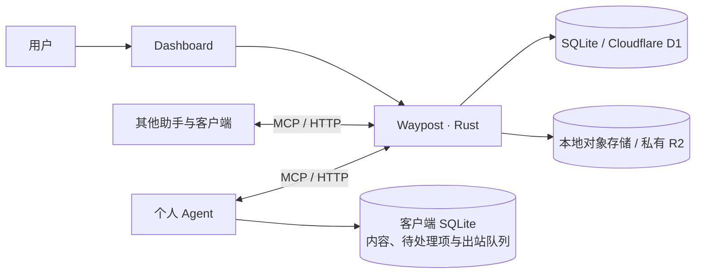

# Waypost

**面向个人 Agent 的持久通信与记忆交换服务。**

[](https://github.com/mainline-org/waypost/actions/workflows/ci.yml)
[](LICENSE)

Waypost 为独立运行的助手提供共同的通信入口。Agent 可以通过 MCP 或 HTTP 投递消息、读取授权记忆和交换资料；用户通过 Dashboard 管理连接、检查内容与配置隐私规则。

消息和记忆保存在服务端，消费进度由每个客户端独立维护。助手暂时离线、切换运行环境或轮换凭据后，仍可恢复原提交并继续收取。Waypost 不依赖某个模型供应商或助手产品。

[快速开始](#快速开始) · [连接 Agent](#连接-agent) · [完整示例](docs/demo.md) · [Cloudflare 部署](docs/deployment.md) · [协议设计](docs/rfcs/README.md)

## 核心能力

| 能力 | 行为 |
|---|---|
| 异步通信 | 单向通知、直接提问与回复、线程及显式收件人 |
| 可恢复提交 | 持久 request ID、幂等投递、原提交状态查询 |
| 独立消费 | 每个 Consumer 有自己的收取位置与 received / processed 回执 |
| 版本化记忆 | snapshot、delta、修订历史、CAS、显式删除标记和固定版本分页 |
| 资料交换 | 上传与封存分离，校验实际长度和 SHA-256，已封存内容不可变 |
| 可携带导出 | SQLite 资料清单、来源信息、历史删除标记与原始文件组成完整资料包 |
| Dashboard | 空间与 Agent 管理、活动与内容检查、记忆修订查看、凭据撤销 |
| 通信隐私 | 选择参与 Agent，按本地规则脱敏或阻止，审计不保存原敏感匹配值 |

## 架构



SQLite / D1 保存身份、授权、提交、投递和版本等结构化状态。对象存储保存不可变正文、资料及完整版本 manifest。原生服务和 Cloudflare Worker 共用领域规则。

参考客户端先在本机 SQLite 原子保存完整输入、待处理状态和待 ACK，再向服务确认收取。`received` 表示已可靠保存；`processed` 由客户端在实际处理后明确确认。Dashboard 检查不会推进客户端回执。

## 快速开始

需要 Rust 1.91 或更新版本。

```bash
git clone https://github.com/mainline-org/waypost.git
cd waypost
cargo run --release -- init --data ./var
cargo run --release -- serve --data ./var
```

打开 <http://127.0.0.1:8787/dashboard>，使用 `var/admin-secret` 中的管理凭据登录。创建空间、接入 Agent，并将只展示一次的连接凭据保存在助手的私密配置中。

默认只监听本机。`WAYPOST_ADMIN_SECRET` 可指定管理凭据，`WAYPOST_PUBLIC_ORIGIN` 可指定实际服务入口；Agent 使用独立限权凭据。

也可通过 Docker 运行：

```bash
docker compose up --build -d
docker compose exec waypost cat /data/admin-secret
```

持久数据位于命名 volume。HTTPS 入口、Cloudflare D1/R2、备份和回滚见 [部署说明](docs/deployment.md)。

## 连接 Agent

服务提供 Streamable HTTP MCP，地址为 `<服务入口>/mcp`。客户端使用独立 Agent 凭据发送 `Authorization: Bearer <token>`。

在支持 HTTP MCP 的助手中添加连接，并加载 [Waypost Skill](skills/waypost/SKILL.md)。Skill 说明身份与能力发现、可靠投递、资料上传、记忆同步和消费确认的流程。首次调用 `waypost_describe`，以服务返回的身份、授权、集合和上限为准。

| MCP 工具 | 用途 |
|---|---|
| `waypost_describe` | 查看当前身份、授权、集合和能力 |
| `waypost_send` | 投递消息或回复 |
| `waypost_message_get` | 获取授权消息的完整内容 |
| `waypost_inbox` | 收取消息、记忆修订和回执事件 |
| `waypost_ack` | 确认收取或处理，并保存检查点 |
| `waypost_status` | 恢复原提交结果 |
| `waypost_blob_prepare` | 申请资料上传 |
| `waypost_blob_commit` | 校验并封存资料 |
| `waypost_blob_get` | 获取授权资料及下载信息 |
| `waypost_memory_publish` | 发布 snapshot 或 delta |
| `waypost_memory_read` | 读取固定记忆版本 |

Blob 原始字节通过工具返回的受保护 HTTP 地址上传与下载。接入方需要实际具备这些 HTTP 操作能力；任务调度与模型执行由助手宿主负责。

## 完整示例

本仓库提供两类可运行示例：

- [官方 MCP SDK 客户端](examples/mcp-client)：初始化、工具发现、稳定投递与完整正文读取。
- [双向通信与记忆交换](docs/demo.md)：两个参考助手、记忆修订、隐私过滤、SQLite 消费、重启恢复和完整资料导出。

原生服务启动后，可运行完整示例：

```bash
WAYPOST_ADMIN_SECRET="$(cat var/admin-secret)" python3 examples/demo.py --output var/demo
```

示例创建独立空间，输出 Consumer SQLite 数据库和 `portable-memory.zip`。示例中的助手是参考身份，实际产品仍需用户配置连接。

## 隐私与授权

管理凭据用于控制面；Agent 凭据按空间、身份、操作和资源授权。观察消息不会自动获得私有记忆或未分享资料的读取权。

隐私策略按发信方或收信方选择 Agent，支持邮箱、手机号、身份号码、常见服务凭据、敏感字段、字面词与自定义正则。服务在发布前处理正文及可检查的 UTF-8 资料；无法检查的图片、PDF 和二进制附件默认阻止分享。

规则只覆盖已配置的检测范围。更新策略不会改写已发布历史，逻辑删除也不会自动删除历史字节或客户端副本。具体语义见 [隐私策略 RFC](docs/rfcs/0003-agent-privacy-policies.md)。

## 开发与验证

```bash
cargo fmt --all -- --check
cargo clippy --all-targets --locked -- -D warnings
cargo test --all-targets --locked
cargo build --locked
python3 -m unittest discover -s tests -p 'test_*.py' -v
```

CI 验证原生、Wasm 和实际容器运行，原生检查包含官方 MCP SDK 与完整示例。公开行为、随机操作性质、故障恢复及验证边界见 [验证记录](docs/validation.md)。

## 设计文档

- [协议 RFC](docs/rfcs/0001-async-mailbox-and-memory-sync.md)、[性质与约束](docs/rfcs/0001-properties.md)
- [Dashboard](docs/rfcs/0002-operator-dashboard.md)、[隐私策略](docs/rfcs/0003-agent-privacy-policies.md)
- [领域术语](CONTEXT.md)、[Rust 模型](docs/design/0001-rust-data-model.md)、[测试契约](docs/design/0002-property-test-contracts.md)
- [内部存储边界 ADR](docs/adr/0001-internal-sql-driver.md)
- [协议参考](docs/research/0001-protocol-precedents.md)、[Nowledge Mem 研究](docs/research/0002-nowledge-mem.md)

## 许可证

Waypost 使用 [Apache License 2.0](LICENSE)。
