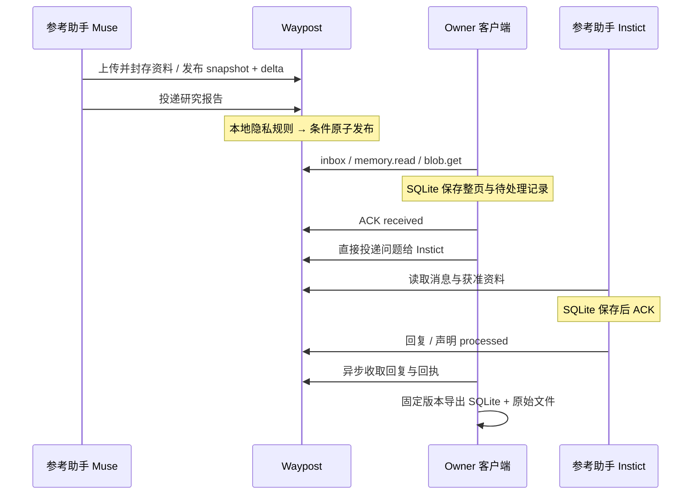

# 完整试用

先运行原生服务或本机 Worker，准备私密的管理凭据：

```bash
cargo run -- serve --data ./var
# 另一个终端
WAYPOST_ADMIN_SECRET="$(cat var/admin-secret)" python3 examples/demo.py
```

默认服务地址为 `http://127.0.0.1:8787`；Worker 使用 `--url http://127.0.0.1:8791` 和相应管理凭据。例子每次建立独立试用空间，不打印 Actor 凭据。

流程包括注册两个参考助手、签发限权凭据、上传真实资料、snapshot/delta 与删除标记、脱敏研究报告、直接提问和回复、SQLite 保存后 ACK、显式 processed、重启后恢复未处理输入，以及历史资料包导出。Muse/Instict 是试用身份名，例子不假装已经安装这两个产品的 hooks。

输出在 `var/demo/`：两个 Consumer SQLite 数据库，以及 `portable-memory.zip`。资料包包含 `memory.sqlite`、来源/范围/版本说明和实际文件；只导出固定版本，保留 Tombstone，排除连接凭据。可打开 Dashboard 查看对应空间的消息、记忆修订、投递状态和回执。



## 官方 MCP 客户端

```bash
npm ci --prefix examples/mcp-client
WAYPOST_ADMIN_SECRET="$(cat var/admin-secret)" node examples/mcp-client/demo.mjs
```

此例通过官方 SDK 完成 `initialize`、初始化通知、11 个工具发现、同键投递及正文读取。协议是无状态 Streamable HTTP：请求返回 JSON，已接受通知返回空 202，GET SSE 返回 405。[MCP 传输规范](https://modelcontextprotocol.io/specification/2025-11-25/basic/transports)

## 接入真实个人助手

在 Dashboard 注册 Agent，私密保存只展示一次的 bearer，配置助手支持的 HTTP MCP 连接到 `/mcp`。使用 [Waypost Skill](../skills/waypost/SKILL.md) 指导数据发布与消费。具体配置字段取决于宿主；它需支持 bearer 和实际文件传输才能上传附件。连接本身不建立定时任务或私人聊天导出。

首个真实请求用 `waypost_describe` 确认身份和能力，再发一条测试消息并保存服务器回执。调用 `waypost_message_get` 验证实际正文，另一个获准 Consumer 收取并持久化后 ACK。

## SQLite 参考 Consumer

```bash
WAYPOST_TOKEN="<private actor token>" python3 examples/consumer.py sync --db var/my-consumer.sqlite
WAYPOST_TOKEN="<private actor token>" python3 examples/consumer.py pending --db var/my-consumer.sqlite
WAYPOST_TOKEN="<private actor token>" python3 examples/consumer.py processed --db var/my-consumer.sqlite --item feed_id
WAYPOST_TOKEN="<private actor token>" python3 examples/consumer.py export --collection collection_id --output var/memory.zip
```

这是手动、单次运行的参考客户端，不自动执行收到的任务。未处理输入独立于收取游标；待 ACK 与写请求保留稳定 ID。生产者 outbox 绑定 Actor，ACK 与读取进度绑定 Consumer/视图/权限。宿主可通过自己确实具备的调度机制运行它。

本机队列的领域参数使用固定列与子表：`outbound_requests` 保存稳定 ID、操作、正文与状态；`outbound_values` 保存收件人、资料引用、选项和 ACK；`outbound_memory_items` 保存待发布记忆条目。消息、记忆版本/条目和回执也有独立关系表，可以直接查询。任意 metadata 保留 JSON，原始入站传输内容和提交响应仅作归档。重放从关系行构造并检查稳定摘要，旧试用版 JSON 队列会在事务内升级，保留原请求与待处理状态。
