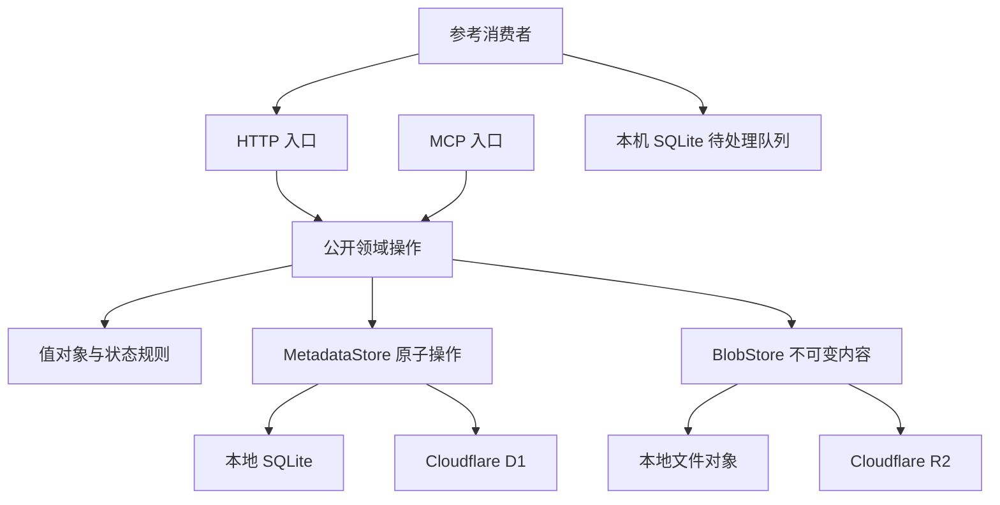

# Rust 领域模型与 SQLite/D1 存储契约

| 项目 | 值 |
|---|---|
| 状态 | Approved design：Step 2 已确认，尚未实现 |
| 日期 | 2026-10-12 |
| 基线 | [RFC-0001](../rfcs/0001-async-mailbox-and-memory-sync.md) |
| 性质 | [P01–P18](../rfcs/0001-properties.md) |
| 已确认 | Rust；结构化状态优先 SQLite/D1；Cloudflare 首个部署；公开仓库；Apache-2.0 |
| 本文输出 | 聚合、值对象、关系模型、原子存储接口及待确认的实现选择 |

本文的数据模型已获确认，尚未创建 Rust 源码、数据库迁移或测试。文中的 Rust 与 SQL 用于说明契约，不代表已经编译或通过生产适配验证。当前进入 Step 3；依其[测试契约](0002-property-test-contracts.md)进入 TDD 实现；用户最新授权免逐步 review。

## 1. 领域与运行边界

Waypost 保存提交、可读取内容、消费声明与来源记忆版本。身份认证、空间隔离和资源授权是所有操作的共同边界。模型推理、自然语言决策、任务执行及记忆语义合并由参与方承担。

首版采用一个 Rust 项目，领域数据与存储行为不依赖 Worker、HTTP 框架或 MCP SDK。默认 Cloudflare 部署使用 D1 和 R2；本地及自托管提供 SQLite 和文件对象存储。SQLite 适配器不通过 D1 管理 REST API模拟一个本地数据库。



不引入微服务、缓存、额外线程池或事件总线。Feed 的事实变化直接进入同一元数据提交；未来通知适配只读取这些事实。异步接口用于适配平台 I/O，不意味着创建多线程执行器。

## 2. 通用语言与聚合边界

完整术语沿用 [CONTEXT.md](../../CONTEXT.md)。以下表明确各个状态由谁管理。

| 聚合或记录 | 管理的状态 | 原子边界 |
|---|---|---|
| Space / 身份配置 | 默认收件人、参与者、来源 URI、凭据及授权配置 | 每次控制面变更原子完成 |
| Submission | 幂等键、指纹、预留资源身份、准备状态、稳定结果 | 唯一键保留；最终结果与业务发布同事务 |
| Thread | 会话身份和获准参与者 | 新会话在消息发布中建立；成员变更由控制面完成 |
| Message | 不可变投递、收件人、附件引用、正文引用 | 与 Submission 和 Feed 同事务发布 |
| Consumer | 固定视图、视图版本、过滤、回执及检查点 | 一次 ACK 的全部回执与检查点同事务 |
| Upload | 预期字节、期限、上传状态和清理排他状态 | 封存与清理条件竞争，只允许一方成功 |
| Blob | 已校验、不可变、可引用的资料事实 | 上传封存或内部资料准备完成后建立 |
| Collection | 固定来源和范围、当前 Revision | expected_revision CAS 与版本发布同事务 |
| Revision | 指定版本的完整条目与删除标记、manifest | 不可变，与 Collection 前进及 Feed 同事务 |

聚合不是独立数据库或服务。发布本身有跨记录原子性，MetadataStore 提供完整业务提交，不把它拆成可以分别成功的公开写操作。

## 3. 值对象

值对象字段保持私有，由校验构造函数建立。传輸 DTO 先解析，再转换为值对象；数据库读出也校验存储范围。

| 类型 | 表示与规则 |
|---|---|
| SpaceId / ActorId / ConsumerId 等 | UTF-8 String；协议对象 ID 的 ASCII 字符集及 1–96 长度 |
| RequestId | ASCII 字符集包含 `.`、`:`；1–128 长度；不作为路径 |
| Revision | Rust u64；公开范围 0 至 2^53−1；SQLite INTEGER |
| VisibleSeq | Rust u64；内部范围 1 至 i64::MAX；公开十进制字符串 |
| Sha256 / Fingerprint | 内部 `[u8; 32]`；数据库 BLOB；需要时转 64 位小写十六进制 |
| Timestamp | 内部 UTC 毫秒整数；公开 RFC 3339；服务时间决定发布事实 |
| RelativePath | 相对标识；拒绝绝对路径、`..` 路径段、空段与反斜杠 |
| Subject | 非空 UTF-8，最多 256 字节 |
| JsonMetadata | 受总字节限制的 JSON 对象；不参与身份和授权 |
| OpaqueCursor | 完整性保护的外部字符串；调用方不可修改位置 |

VisibleSeq 可以使用数据库全局序号，Space 授权与过滤决定可见范围；不同空间共享计数器不会使对象变得可读。数据库生成序号到达 i64 上限后返回 RESOURCE_LIMIT，不回绕。

D1 经 JavaScript 边界返回大整数时可能发生精度损失。序号查询使用 `CAST(sequence AS TEXT)`，绑定大序号使用十进制字符串及显式整数转换，不先转 JavaScript Number。Revision 保持 RFC 已规定的安全整数上限。

请求指纹采用 RFC 8785 JCS 与 SHA-256。收件人集合先排序；附件、正文选项等有序列表保持顺序。服务生成的资源 ID、时间、授权凭据不进入请求指纹。省略的默认收件人在首次保留时固定；新建会话的请求仍以“创建新会话”的语义计算指纹，预留会话 ID另行保存。

## 4. Rust 数据结构

以下代码省略 derive、序列化属性和校验构造函数；不使用一个 serde_json::Value 承载所有领域数据。

### 4.1 认证上下文

```rust
pub struct Principal {
    space_id: SpaceId,
    actor_id: ActorId,
    consumer_id: ConsumerId,
    credential_id: TokenId,
    actor_authority_version: u64,
    credential_authority_version: u64,
    grant_fingerprint: Fingerprint,
    grants: Grants,
}

pub struct Grants {
    scopes: Vec<Scope>,
    recipient_ids: Vec<ActorId>,
    collection_ids: Vec<CollectionId>,
    referenceable_blob_ids: Vec<BlobId>,
}

pub enum Scope {
    MessageSend, MessageRead, SpaceObserve, ReceiptWrite,
    MemoryWrite, MemoryRead, BlobWrite, BlobReference,
    EventSubscribe,
}
```

集合规范化为排序且唯一的列表。空列表的含义逐项按 RFC 定义，不能一律解释成“全部资源”。BlobReference 是 RFC 9.2 明确的重引用授权，只有控制面能授予。身份与 grant_fingerprint 不由输入正文提供。

Principal 是请求起点的认证事实，不是永久提交许可。最终提交在同一数据库原子操作中检查当前凭据、到期、撤销、Actor 状态、Consumer 视图、资源及所需授权。指纹来自实际权限与资源授予，排除 token ID，使同权限凭据轮换可继续使用游标。

### 4.2 提交与稳定结果

```rust
pub struct SubmissionKey {
    space_id: SpaceId,
    producer_id: ActorId,
    operation: Operation,
    request_id: RequestId,
}

pub struct Submission {
    id: SubmissionId,
    key: SubmissionKey,
    fingerprint: Fingerprint,
    reservation: ReservedResource,
    state: SubmissionState,
}

pub enum SubmissionState {
    Reserved { reserved_at: Timestamp },
    Prepared { artifact: PreparedArtifact },
    Committed { committed_at: Timestamp, result: CommitResult },
    Failed { error: RecordedFailure },
}

pub enum CommitResult {
    Message { message_id: MessageId, thread_id: ThreadId },
    BlobPrepared { upload_id: UploadId, blob_id: BlobId, expires_at: Timestamp },
    BlobSealed { blob_id: BlobId },
    Memory { collection_id: CollectionId, revision: Revision, changed: bool },
    Ack { items: Vec<AckedItem>, checkpoint: Option<Checkpoint> },
}
```

Operation 使用领域名，覆盖 message.send、receipt.ack、blob.prepare、blob.commit、memory.publish。只读操作没有提交键。控制面创建操作使用独立的管理员幂等账本，不冒充一个普通 Actor。

ReservedResource 明确记录已预留的 Message/Thread、Upload/Blob 或目标 Collection 等身份。并发重试唯一键保留失败后读回已有保留，不能换资源 ID。

PreparedArtifact 引用已验证的正文或完整记忆 manifest、大小和摘要。RecordedFailure 使用领域错误码与明确字段，例如冲突时的 current_revision；临时网络或存储错误不进入永久 failed。

提交结果采用固定字段及结果关联表保存。不能用后来变化的回执或 Collection head重建“原请求结果”。

### 4.3 消息与 Feed

```rust
pub struct Message {
    id: MessageId,
    space_id: SpaceId,
    producer_id: ActorId,
    thread_id: ThreadId,
    in_reply_to: Option<MessageId>,
    recipient_ids: Vec<ActorId>,
    kind: MessageKind,
    subject: Subject,
    body_ref: ObjectRef,
    attachment_ids: Vec<BlobId>,
    committed_at: Timestamp,
}

pub enum MessageKind {
    Info, Question, Result, TodoSuggestion,
    MemoryNotice, ProcessingResult,
}

pub struct FeedItem {
    id: FeedItemId,
    space_id: SpaceId,
    sequence: VisibleSeq,
    producer_id: ActorId,
    recipient_ids: Vec<ActorId>,
    thread_id: Option<ThreadId>,
    committed_at: Timestamp,
    data: FeedData,
}

pub enum FeedData {
    Message { message_id: MessageId, subject: Subject, kind: MessageKind },
    MemoryRevision { collection_id: CollectionId, revision: Revision,
                     parent_revision: Revision, manifest_blob_id: BlobId },
    Receipt { receipt_id: ReceiptId, receipt_version: u64,
              subject_item_id: FeedItemId, subject_resource_id: ResourceId,
              consumer_id: ConsumerId, actor_id: ActorId,
              stage: ReceiptStage, updated_at: Timestamp },
}
```

MessageBody 使用 `text: String`、`options: Vec<String>` 和固定来源字段；不可变正文保留在对象存储。SQL 中保存用于查询的 subject/kind 与引用，不把整个信箱放入 JSON 文件。ObjectRef 是服务生成的内部对象身份，客户端不能指定 bucket 或键。

Feed 的 message 和 memory 摘要可从不可变发布记录读取。Receipt 摘要必须保存每一次状态推进时的快照，不能 join当前回执后把历史阶段变成最新阶段。

### 4.4 Consumer 与回执

```rust
pub struct Consumer {
    id: ConsumerId,
    space_id: SpaceId,
    actor_id: ActorId,
    view: ConsumerView,
    view_revision: u64,
    filter: FeedFilter,
    disabled: bool,
}

pub enum ConsumerView { Inbox, SpaceLog }
pub enum ReceiptStage { Received, Processed }

pub struct Receipt {
    id: ReceiptId,
    consumer_id: ConsumerId,
    subject_item_id: FeedItemId,
    stage: ReceiptStage,
    version: u64,
    updated_at: Timestamp,
}

pub struct Checkpoint {
    consumer_id: ConsumerId,
    view_revision: u64,
    grant_fingerprint: Fingerprint,
    sequence: u64,
}
```

没有回执行表示 none，不新增第三个“未收到”状态行。processed 可以从 none直接建立。Checkpoint 起点为 0，未必已有 Feed；其位置类型与必须大于 0 的 VisibleSeq 区分。

FeedFilter 仅包含 RFC 允许的 producer_ids、thread_ids、item_types、collection_ids。游标内部包含 Space、Actor、Consumer、视图版本、过滤指纹、有效授权指纹、位置与游标版本。首版采用有版本的固定编码和 HMAC-SHA256，不需要保存所有分页游标。

### 4.5 Upload 与 Blob

```rust
pub struct Upload {
    id: UploadId,
    blob_id: BlobId,
    space_id: SpaceId,
    owner_id: ActorId,
    expected_size: u64,
    expected_sha256: Sha256,
    content_type: String,
    filename: Option<String>,
    object_ref: ObjectRef,
    expires_at: Timestamp,
    state: UploadState,
}

pub enum UploadState { AwaitingContent, Stored, Sealed, Cleaning }

pub struct Blob {
    id: BlobId,
    space_id: SpaceId,
    owner_id: ActorId,
    object_ref: ObjectRef,
    size: u64,
    sha256: Sha256,
    content_type: String,
    sealed_at: Timestamp,
}
```

Upload 的 blob_id 在 prepare时固定，但有效 Blob 行只在封存时建立。零字节内容合法。写入使用 create-only，已存在时比较真实的已校验对象事实；R2 条件写失败不能直接当作成功。

封存后的读取权来自所有权、已发布消息/记忆的引用或明确授权。暂存期限只影响未封存资料。上传与提交租约保存在元数据内，Cleaning只能在没有有效租约及已发布引用时取得；迟到 PUT无法覆盖已有对象。

### 4.6 Collection、Revision 与条目

```rust
pub struct Collection {
    id: CollectionId,
    space_id: SpaceId,
    source_actor_id: ActorId,
    scope: String,
    current_revision: Revision,
}

pub struct PublishedRevision {
    collection_id: CollectionId,
    revision: Revision,
    parent_revision: Revision,
    manifest_blob_id: BlobId,
    state_fingerprint: Fingerprint,
    committed_at: Timestamp,
}

pub struct MemoryEntry {
    item_id: MemoryItemId,
    state: MemoryEntryState,
}

pub enum MemoryEntryState {
    Active { blob_id: BlobId, path: RelativePath, metadata: JsonMetadata },
    Tombstone { deleted_in_revision: Revision },
}

pub enum MemoryInput {
    Inline { items: Vec<MemoryItemInput>, delete_ids: Vec<MemoryItemId> },
    Manifest { blob_id: BlobId },
}

pub struct PublishMemory {
    request_id: RequestId,
    collection_id: CollectionId,
    expected_revision: Revision,
    mode: MemoryMode,
    input: MemoryInput,
}

pub enum MemoryMode { Snapshot, Delta }
```

MemoryInput 在内部类型中保证两种输入互斥，DTO 校验同时提供或缺失的输入。Snapshot 的 delete_ids 必须为空；Delta 的 upsert与delete互斥。未删除的旧 Tombstone在后续版本保留，明确 upsert才恢复。

每一个已发布 Revision 直接保存完整关系行集合，包括 Tombstone。通过 Collection head选择当前版本；首版不维护另一份可变 current_items，不引入历史回放或结构共享算法。版本 0 是虚拟空集合，没有 manifest或版本行。

完整版本行可能增加历史容量，这是为了直观的固定版本读取而采用的简单实现；容量由部署限额控制。若实际测量证明需要优化，另评估版本行复用，保持公开语义。

状态指纹覆盖按 item_id排序的 active条目与 Tombstone，以及语义 metadata；排除提交时间与正在分配的 revision。需要比较实际语义状态，不能把指纹一致当作绕过 head CAS的条件。

## 5. SQLite 关系模型

### 5.1 约定

- 对象 ID 使用 TEXT；同空间关系使用复合外键 `(space_id, object_id)`，避免只凭一个 ID连接跨空间对象。
- 摘要使用长度为 32 的 BLOB；布尔和枚举有 CHECK；版本和时间使用 INTEGER。
- 明确 NOT NULL、唯一约束和外键；本地每条连接启用 foreign_keys，D1 使用其外键机制。
- metadata是受限 TEXT JSON对象；仅该类可扩展内容采用 JSON列。生产者、权限、状态和关联关系不得塞入该列。
- FK 不自动跨已发布历史级联删除；v0.1停用身份和逻辑删除不物理移除历史资料。
- 核心 SQL与关系规则共享，SQLite事务与 D1 batch的执行适配分开。

### 5.2 表清单

这是目标模型清单，按实施切片逐步创建迁移，不提前建立空表。

| 表 | 主键 / 主要唯一约束 | 主要字段与用途 |
|---|---|---|
| spaces | space_id；source_uri唯一 | display_name、default_actor_id、固定来源 URI |
| actors | (space_id, actor_id) | kind、display_name、disabled、authority_version |
| consumers | (space_id, consumer_id) | actor_id、view、view_revision、disabled |
| consumer_filters | (space_id, consumer_id, dimension, value) | 固定过滤集合 |
| tokens | token_id；token_digest唯一 | space_id、actor_id、consumer_id、授权代次、期限、撤销 |
| token_scopes | (token_id, scope) | 固定 scope集合 |
| token_recipient_grants | (token_id, recipient_actor_id) | 获准投递对象 |
| token_collection_grants | (token_id, collection_id, action) | 获准读取/写入来源记忆 |
| token_blob_reference_grants | (token_id, blob_id) | 明确的额外重引用范围 |
| threads | (space_id, thread_id) | created_at |
| thread_members | (space_id, thread_id, actor_id) | 所有者批准的参与者 |
| submissions | submission_id；(space_id, producer_id, operation, request_id)唯一 | 指纹、状态、预留身份、准备引用、稳定结果、明确错误、租约 |
| submission_recipients | (submission_id, actor_id) | 首次固定的有效收件集合 |
| submission_ack_items | (submission_id, position) | 原 ACK响应的 item、stage和状态版本 |
| admin_submissions | (operation, request_id) | 管理员创建操作的指纹与稳定资源结果 |
| messages | (space_id, message_id)；submission_id唯一 | producer、thread、reply、subject、kind、正文引用、发布时间 |
| message_recipients | (space_id, message_id, actor_id) | 投递关系 |
| message_attachments | (space_id, message_id, position) | blob_id，保留附件顺序 |
| feed_items | sequence INTEGER PRIMARY KEY AUTOINCREMENT；item_id唯一 | Space、类型、资源、版本、来源、会话、发布时间 |
| feed_recipients | (space_id, item_id, actor_id) | 消息与回执的收件关系；记忆仍按 Collection授权 |
| feed_receipt_updates | (space_id, item_id) | 回执推进时的不可变类型专属数据 |
| receipts | (space_id, receipt_id)；(space_id, consumer_id, subject_item_id)唯一 | stage、version、updated_at |
| consumer_checkpoints | (space_id, consumer_id, view_revision, grant_fingerprint) | sequence、updated_at |
| uploads | (space_id, upload_id)；blob_id唯一 | 预期与已验证资料、期限、状态、上传/提交租约 |
| blobs | (space_id, blob_id)；object_ref唯一 | 所有者、大小、类型、SHA-256、sealed_at |
| collections | (space_id, collection_id) | source_actor_id、不可变 scope、current_revision |
| memory_revisions | (space_id, collection_id, revision)；submission_id唯一 | parent_revision、manifest_blob_id、状态摘要、发布时间 |
| memory_revision_items | (space_id, collection_id, revision, item_id) | active/tombstone、blob_id、path、metadata、deleted_in_revision |

所有 token授予的关联表也保存对应 space_id并使用复合外键，确保所引用的 Actor、Collection或 Blob属于 token空间。表格中的主键简写不省略这一隔离要求。

Space创建同时建立默认 Actor。二者的外键循环使用同一次创建事务内的延迟外键约束；默认 Actor在后续控制面操作中保持不变。普通数据面无修改默认 Actor的方法。

### 5.3 必要索引

| 查询 | 索引或约束 |
|---|---|
| 验证 Bearer | tokens(token_digest)唯一 |
| 查询原提交 | submissions唯一幂等键 |
| 空间增量分页 | feed_items(space_id, sequence) |
| Actor收件范围 | feed_recipients(space_id, actor_id, item_id) |
| Collection变化范围 | feed_items(space_id, item_type, resource_id, sequence) |
| 会话增量过滤 | feed_items(space_id, thread_id, sequence) |
| 查消费者回执 | receipts(space_id, consumer_id, subject_item_id)唯一 |
| 固定版本记忆分页 | memory_revision_items的主键顺序 |
| 单版本 active路径唯一 | memory_revision_items上的 partial UNIQUE索引 |
| 检查附件引用 | message_attachments(space_id, blob_id) |
| 检查记忆资料引用 | memory_revision_items(space_id, blob_id) |
| 可清理上传 | uploads(state, expires_at) |

仅建立公开操作确实使用的索引。查询继续在权限与视图交集内执行，不能“取所有数据后仅由客户端过滤”。

### 5.4 代表性结构草图

以下是结构约束示例，不是当前已执行的迁移。完整迁移在 Step 4按已确认模型编写。

```sql
CREATE TABLE collections (
    space_id TEXT NOT NULL,
    collection_id TEXT NOT NULL,
    source_actor_id TEXT NOT NULL,
    scope TEXT NOT NULL,
    current_revision INTEGER NOT NULL DEFAULT 0
        CHECK (current_revision BETWEEN 0 AND 9007199254740991),
    PRIMARY KEY (space_id, collection_id),
    FOREIGN KEY (space_id, source_actor_id)
        REFERENCES actors(space_id, actor_id)
);

CREATE TABLE memory_revisions (
    space_id TEXT NOT NULL,
    collection_id TEXT NOT NULL,
    revision INTEGER NOT NULL CHECK (revision > 0),
    parent_revision INTEGER NOT NULL CHECK (parent_revision >= 0),
    submission_id TEXT NOT NULL UNIQUE,
    manifest_blob_id TEXT NOT NULL,
    state_fingerprint BLOB NOT NULL CHECK (length(state_fingerprint) = 32),
    committed_at INTEGER NOT NULL,
    PRIMARY KEY (space_id, collection_id, revision),
    CHECK (revision = parent_revision + 1),
    FOREIGN KEY (space_id, collection_id)
        REFERENCES collections(space_id, collection_id),
    FOREIGN KEY (space_id, manifest_blob_id)
        REFERENCES blobs(space_id, blob_id)
);

CREATE TABLE memory_revision_items (
    space_id TEXT NOT NULL,
    collection_id TEXT NOT NULL,
    revision INTEGER NOT NULL,
    item_id TEXT NOT NULL,
    entry_kind TEXT NOT NULL CHECK (entry_kind IN ('active', 'tombstone')),
    blob_id TEXT,
    path TEXT,
    metadata_json TEXT,
    deleted_in_revision INTEGER,
    PRIMARY KEY (space_id, collection_id, revision, item_id),
    CHECK (
        (entry_kind = 'active' AND blob_id IS NOT NULL AND path IS NOT NULL
         AND metadata_json IS NOT NULL AND deleted_in_revision IS NULL)
        OR
        (entry_kind = 'tombstone' AND blob_id IS NULL AND path IS NULL
         AND metadata_json IS NULL AND deleted_in_revision IS NOT NULL
         AND deleted_in_revision > 0 AND deleted_in_revision <= revision)
    ),
    FOREIGN KEY (space_id, collection_id, revision)
        REFERENCES memory_revisions(space_id, collection_id, revision),
    FOREIGN KEY (space_id, blob_id)
        REFERENCES blobs(space_id, blob_id)
);

CREATE UNIQUE INDEX memory_active_path
ON memory_revision_items(space_id, collection_id, revision, path)
WHERE entry_kind = 'active';
```

## 6. 显式存储接口

接口返回领域可解释的结果。StoreError仅代表存储不可用等适配失败；版本冲突、凭据已失效与稳定重试是明确的操作结果，不能伪装成数据库执行成功。

```rust
pub trait MetadataStore {
    async fn authenticate(&self, credential: CredentialDigest, now: Timestamp)
        -> Result<Principal, AuthError>;

    async fn reserve_submission(&self, input: ReserveSubmission)
        -> Result<ReservationOutcome, StoreError>;

    async fn load_submission(&self, principal: &Principal, key: SubmissionKey)
        -> Result<Submission, LookupError>;

    async fn mark_prepared(&self, input: MarkPrepared)
        -> Result<PrepareOutcome, StoreError>;

    async fn commit_message(&self, input: CommitMessage)
        -> Result<MessageCommitOutcome, StoreError>;

    async fn commit_revision(&self, input: CommitRevision)
        -> Result<RevisionCommitOutcome, StoreError>;

    async fn acknowledge(&self, input: Acknowledge)
        -> Result<AckOutcome, StoreError>;

    async fn read_feed(&self, input: ReadFeed)
        -> Result<FeedPage, ReadError>;

    async fn read_message(&self, input: ReadMessage)
        -> Result<Message, ReadError>;

    async fn read_memory(&self, input: ReadMemory)
        -> Result<MemoryPage, ReadError>;

    async fn prepare_upload(&self, input: PrepareUpload)
        -> Result<UploadPrepared, StoreError>;

    async fn seal_upload(&self, input: SealUpload)
        -> Result<SealOutcome, StoreError>;
}
```

上述 MetadataStore 为设计阶段的原子操作草图。实现阶段按 [ADR-0001](../adr/0001-internal-sql-driver.md) 修订执行边界：共享核心持有具名领域操作和发布规则，SQLite/D1 只实现 crate-private SQL 驱动。原始 SQL 不作为客户端或 Rust 公共存储 API；不建立通用 Repository<T> 或动态插件注册。Future 保持本地，不要求 Send 或 async_trait；Worker 的流式字节处理保留在适配器内。

### 6.1 参数与结果

| 参数 | 必需信息 | 可观察结果 |
|---|---|---|
| ReserveSubmission | 当前主体、领域操作、原 request_id、规范化指纹、候选预留身份与固定默认值 | New、ExistingPending、ExistingCommitted、ExistingFailed、Conflict或Denied |
| MarkPrepared | 原提交、当前主体、实际可读取的不可变正文/manifest事实 | Prepared、既有结果、冲突或当前授权失败 |
| CommitMessage | 原提交、认证版本、准备资料、固定收件人和会话引用、服务提交时间 | Committed、既有稳定结果、Pending、Denied或固定业务失败 |
| CommitRevision | 原提交、认证版本、Collection、expected_revision、完整下一状态、manifest或无变化判定 | Published、Unchanged、Existing、RevisionConflict或Denied |
| Acknowledge | 原提交、Consumer绑定视图、有效授权指纹、最多20项及可空检查点 | 原子保存的稳定结果或整批拒绝 |
| ReadFeed | 当前主体、Consumer、已验证游标、limit | 获准且有序的 FeedPage与下一游标位置 |
| ReadMemory | 当前主体、Collection、明确或游标绑定的 revision、tombstone选项、limit | 单一固定版本的 MemoryPage |
| SealUpload | 原提交、当前主体、Upload、已核验对象事实和当前时间 | 固定封存结果、未就绪、到期、清理竞争或授权失败 |

ReadFeed和ReadMemory仍必须执行当前授权检查。页查询中的权限、过滤与数据读取需要一致的元数据视图；不能只依赖查询前的内存检查。首版不启用 D1读副本，减少初始一致性与撤销边界的复杂度。

BlobStore提供 `create_only(object_ref, stream, expected)`、`inspect(object_ref)`、`read(object_ref)` 与取得清理许可后的 `remove(object_ref)`。create_only返回 Created或AlreadyPresent，带实际验证的大小、类型和摘要；流的具体类型留在实现契约中固定，不把请求 body缓冲成 Vec<u8>作为唯一 API。服务负责读取/引用授权，BlobStore不接受用户提供的桶地址。

控制面提供 create_space、create_actor、create_consumer、create_collection、issue_token、revoke_token、disable_actor；附加会话成员授权操作由同一管理员边界负责。会话成员授权路径将在传输契约中明确，普通 message.send不扩大参与范围。

## 7. 原子提交与数据库差异

### 7.1 提交前准备

1. 验证 schema与当前授权。
2. 通过唯一键保留提交，固定指纹、资源身份和默认值。
3. 准备不可变正文或完整 manifest，校验附件/条目 Blob，记录 prepared。
4. 执行一个 MetadataStore原子业务操作。
5. 提交完成后返回稳定结果，响应丢失时查询原键。

这些阶段之间可能重启。恢复所需身份、指纹、准备对象与稳定结果都在耐久存储内。已提交或失败的原结果仍需通过当前授权检查才能返回。

### 7.2 SQLite

本地原子操作使用短事务，事务内检查授权和原提交、条件推进 Collection、写不可变版本/消息与 Feed、保存稳定结果。需要争取写入边界时使用 BEGIN IMMEDIATE，避免把应用层先读后写当作 CAS。

文件对象存储采用临时写入、内容验证、文件与必要目录同步、create-only发布；其成功表示满足已约定的耐久写契约。它不与 SQLite形成跨存储事务，因此仍遵循 prepare → metadata commit流程。

### 7.3 D1

D1 batch用于完整原子提交，不能把本地事务闭包或逐次 async BEGIN/UPDATE/COMMIT直接映射到 D1。需要采用一次 batch内的提交条件：

- 原提交仍属于当前主体且尚未完成。
- 当前凭据、Actor、所需资源和授权允许操作。
- Collection head等于 expected_revision，或 ACK绑定视图仍有效。
- 资料引用仍为已封存状态。

guard未命中时所有业务写入必须无副作用。所有后续写入由本次提交条件保护；一次 UPDATE执行成功但改变0行不等于发布成功。CAS失败记录原提交的稳定冲突结果，不插入新版本或 Feed。无变化操作也在同一 batch条件下保存结果，不增加版本和 Feed。

将 D1执行 SQL的结果与业务成功分开解码。提交响应丢失时先查询原提交，不能重新分配资源或盲目再次追加序号。实际 guard SQL在 Step 4实现，由 Step 3确定的公开性质与适配契约验证。

D1的每次 Worker调用查询预算、每条语句参数数和长度限制同时约束完整版本写入。Free当前每次调用最多50个查询、每条查询最多100个绑定参数；不能假设一次 batch可以绕过这些限制。D1部署通过 describe公布更小的 Collection条数、请求大小和变更上限，并在产生任何可见副作用前整批拒绝超限输入。具体可支持值在 Step 4通过真实适配测量确认，不预先承诺默认10,000条在免费部署上可用。本地 SQLite部署可采用 RFC上限。依据：[D1平台限制](https://developers.cloudflare.com/d1/platform/limits/)。

依据：[D1 batch与事务](https://developers.cloudflare.com/d1/worker-api/d1-database/)、[D1结果与 changes](https://developers.cloudflare.com/d1/worker-api/return-object/)。这里的 guard方案是本项目设计，平台文档不替项目证明 CAS正确性。

## 8. 不可变对象与记忆 manifest

对象存储保存三类内容：消息正文、用户资料、服务生成的完整版本 manifest。每一对象都有服务生成的独立引用和被验证的摘要，首版不做跨空间去重。

记忆输入 manifest保持 RFC已有 `{items, delete_ids}` 格式。服务生成的完整版本 manifest采用明确的 manifest_version、Collection、revision、parent_revision、完整 active条目和 Tombstone；两者为不同用途的格式，不能将 delta输入当作完整导出版本。

完整版本 manifest与关系行描述同一个已发布状态。关系行是服务分页与授权查询的依据，manifest是可携带内容及对象引用。发布前二者由同一经过校验的状态生成，测试分别读取二者进行一致性验证。

没有内容变化时不创建新有效版本。即使准备阶段留下未引用的内部对象，也不能进入 Feed或伪造版本；清理必须遵循资料保留与租约规则。

## 9. 参考消费者的本机 SQLite

参考消费者只负责可靠收取和展示待处理状态，不自动执行自然语言中的外部行动。它使用与服务分开的数据库文件。

| 本机表 | 关系与含义 |
|---|---|
| local_feed_items | item_id唯一，空间、来源、序号、类型、资源和版本 |
| local_messages | 原消息身份与固定正文/资料引用；常用正文保存 TEXT |
| local_receipt_updates | 收到的回执推进事实 |
| local_memory_versions | 收到的来源 Collection与固定版本 |
| local_work | item_id关联待处理、处理中、已处理状态及明确错误 |
| local_checkpoints | Consumer、视图和授权指纹对应的可靠保存位置 |
| local_outbound | 稳定 request_id、领域操作、规范化待发参数与当前提交结果 |

一页内容、待处理项和本机检查点先在一笔 SQLite事务中保存，再发 received ACK。ACK响应丢失时仍保留本机记录。processed只在参考客户端明确确认处理后发送。出站参数采用固定列和子表，metadata仍可使用受限 JSON。

具体参考客户端接口与 P17故障点在 Step 3确认；该客户端不保证其他未遵循保存流程的助手也具有本机可靠性。

## 10. Dashboard 管理读取扩展

用户新增首版 Dashboard要求，具体契约见 [RFC-0002](../rfcs/0002-operator-dashboard.md)。它复用原有聚合，通过独立管理员身份提供具名读取与已有控制面操作。新增 admin_sessions关系表保存会话摘要与期限；浏览器不获得数据库或对象存储管理凭据。

Inspector展示已发布事实、固定记忆版本与独立回执，不修改 Consumer进度。首版先展示服务已记录的活动；外部执行轨迹的显式上报作为独立扩展，后续明确范围再实施。

## 11. 已确认的模型决定

用户已确认：

1. 采用以上聚合和值对象，公开 DTO与领域类型分开。
2. 服务结构化状态使用 SQLite/D1关系表；正文、资料与版本 manifest使用不可变对象存储。
3. 历史记忆版本保存完整关系行，当前状态由 head选择，暂不增加可变镜像或历史重放算法。
4. MetadataStore暴露完整原子业务操作，D1与本地 SQLite分别实现提交机制。
5. 原始结果、回执变化快照和分视图检查点分别保存，避免用可变现态替代历史事实。
6. 参考消费者使用单独 SQLite数据库，保存后 ACK；测试限定在已确认的公开边界。
7. Dashboard使用独立管理会话与关系查询，加入首版的内容检查和身份管理。

Step 3将 P01–P18映射为 Rust proptest命令模型、真实存储契约与确定性故障回归；依其测试契约进入 Step 4；用户最新授权免逐步 review。

## 12. 参考依据

- [RFC-0001](../rfcs/0001-async-mailbox-and-memory-sync.md)：本项目的操作语义。
- [SQLite类型与范围](https://www.sqlite.org/datatype3.html)：INTEGER等存储类型依据。
- [SQLite外键](https://www.sqlite.org/foreignkeys.html)：复合外键与约束依据。
- [D1 SQL支持](https://developers.cloudflare.com/d1/sql-api/sql-statements/)：共享 SQL适配范围。
- [D1外键](https://developers.cloudflare.com/d1/sql-api/foreign-keys/)：D1的约束语义。
- [D1 batch](https://developers.cloudflare.com/d1/worker-api/d1-database/)：平台原子批处理依据。
- [Cloudflare Rust Workers](https://developers.cloudflare.com/workers/languages/rust/)：部署适配依据。
