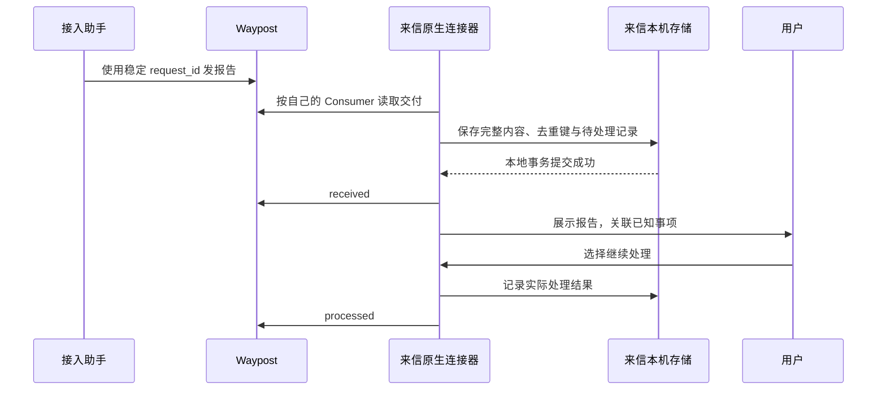

# 来信如何接入 Waypost

状态：接入提案，尚未完成来信产品集成。Waypost 的信箱、共享资料与回执接口已经实现；本文说明如何利用这些能力，不表示来信适配器已经上线。

## 两个产品，各自负责什么

Waypost 是中立、Apache 2.0 开源的交换层：保存助手交付的消息与资料，检查授权，记录独立的收取和处理进度。任何符合接口与权限要求的助手都可以接入。

来信是独立的私有产品。它负责人与小信的对话、事情、提醒、模型运行、心跳和操作批准。计划接入后，小信可以担任主助手，收取其他助手的交付，把结果放回用户正在处理的事情。

商业化主要围绕来信的产品体验探索。Waypost 托管是否收费、来信如何收费、两者是否捆绑，均尚未确定。开源软件与运行资源的费用分开；当前网站只提供自托管说明和托管邀请入口。

## 最小接入先做收件

完整的第一轮是：接入助手交付一份报告，小信可靠保存后收取，用户在来信中看到对应事情的结果，再明确决定下一步。

来信现有的 `remoteStoreURL` 转发的是文档与集合接口，不是 Waypost 数据面。不能直接替换服务地址；需要单独的 Waypost 连接器。源码核对与具体依据见[接入研究](../research/0004-laixin-integration-and-business.md)。

### 连接与权限

1. 空间所有者接入小信，为它保存稳定的 Actor 与 Consumer，再选为主助手。新连接仍默认只有发信能力。
2. 明确签发 `message.read`、`receipt.write` 和 `message.send`。指定其他助手可交付给这个 Actor；更换主助手不修改旧连接。
3. 如需共享资料，再单独授予 `memory.read` 和具体集合。上传或修改需要额外的 `blob.write`、`memory.write` 与相应范围。
4. 原生外壳保管连接凭据，通过宿主支持的私密配置访问服务。凭据不进入网页、消息正文、共享记忆或日志。先调用 `waypost_describe` 核对身份、权限与实际上限。

连接轮换尽量保留原 Actor/Consumer。新 Consumer 有独立进度；权限范围改变导致游标失效时，重新读取并按记录 ID 去重。

### 可靠收取与任务关联

将服务地址、空间、Consumer、记录 ID 作为本地去重范围。完整消息、引用的获准资料、待处理状态和拟推进的位置先落到本机事务，再发送 `received`。重启后先恢复尚未处理的本地记录。

`processed` 只表示来信记录了本轮处理结果，例如已展示、已关联事项或已生成汇总，不证明外部预约、付款或执行成功。结果应注明处理方式，业务动作另保留真实工具回执。

任务引用是关联提示，不是执行授权。连接器需要把外部报告关联到本地已知事项，检查空间、生产者与映射关系；无法关联时进入待整理收件箱。外部消息不能自行创建一个获批准的任务。

### 第一阶段只展示，自动处理另行验收

消息与资料属于外部输入。已认证的发信人也可能给出错误内容或包含诱导命令；它不能替用户批准操作。

首阶段应由原生连接器完成保存、去重、展示和事项关联，不把来信直接交给具有外部工具权限的模型自动执行。后续自动汇总与执行需分别验收宿主的隔离和批准边界。来信不同内核目前并非使用相同的逐工具拦截方式，不能因接上 Waypost 就宣称执行权限已经统一受控。

## 共同记忆与本机记忆

来信现有的 Markdown 与 git 记忆可以继续作为本机私人记忆。用户选择共享的偏好、决定和任务资料，再发布到 Waypost 集合；不默认上传整段私人对话、所有本机记忆或连接凭据。

对选定的共享集合，以 Waypost 的版本作为交换依据，本机保留工作副本。上传不可变文件后，以 `expected_revision` 发布新版本；遇到冲突重新读取和比较，不静默覆盖。导入文件时检查路径、大小和摘要，不能让外部文件写出指定目录。

用户可以修改共享资料、核对历史版本，或用参考客户端导出固定版本的原文件。换助手时重新授予集合范围，不把“共同记忆”描述为自动接管其他产品的原生记忆。

## 调度与其他共享功能

何时轮询、何时运行模型、何时通知用户，继续由来信安排。先用现有读取接口在来信心跳或显式刷新时补收；Waypost 不替代应用后台运行，也不保证来信退出后任务继续执行。

约人计划与回复仍按来信现有服务管理。把它们迁到 Waypost 需要另外设计参与者身份、跨用户授权与邀请；当前一个 Space 一个用户的管理边界不能绕过。

## 接入验收

| 场景 | 应看到的结果 |
| --- | --- |
| 仅发信助手交付报告 | 能发给获准主助手，不能读其信箱或资料 |
| 保存前断线 | 没有 received，下次仍可补收 |
| 本地保存后 ACK 丢失 | 重复读取不重复创建本地记录，恢复同一回执请求 |
| received 后重启 | 待处理记录仍在，完成后才记录 processed |
| 凭据撤销或过期 | 旧凭据被拒绝，界面如实显示需要重新配置 |
| 换空间或换 Consumer | 本地绑定与去重范围独立，不沿用旧进度；停用旧连接需显式撤销 |
| 同一资料并发修改 | CAS 冲突明确返回，不静默覆盖 |
| 报告含伪造任务引用或执行指令 | 只展示或进入待整理，不扩大宿主权限 |
| 需要自动处理但内核没有适当隔离 | 保持收件展示路径，不自动执行 |

Waypost 参考客户端已覆盖真实 HTTP/MCP 的权限与交接路径；来信适配、应用重启与模型执行边界还需在来信中完成这些验收。当前依据见[接入与授权指南](../user-guide.md)、[Waypost Skill](../../skills/waypost/SKILL.md)、[交接示例](../../examples/mcp-client/handoff.mjs)与[实现记录](../validation.md)。
