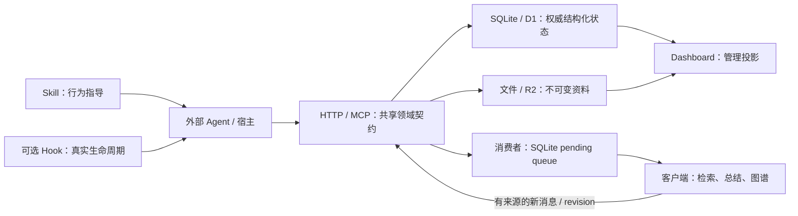

# 0002：Nowledge Mem 对 Waypost 的产品与契约启发

- 检索日期：2026-10-12。
- 范围：官方产品文档、官方 API、官方公开社区集成与插件配置。
- 基线：[RFC-0001](../rfcs/0001-async-mailbox-and-memory-sync.md)、[P01–P18](../rfcs/0001-properties.md)、[Rust 数据模型](../design/0001-rust-data-model.md)、[Dashboard RFC](../rfcs/0002-operator-dashboard.md)、[Step 3 测试契约](../design/0002-property-test-contracts.md)。
- **事实**是来源直接描述；**Waypost 建议**是本项目推论；**后续提案**尚未成为已确认规范。本笔记不增加必需 API、schema、聚合或实现代码。

## 1. 产品范围与开源边界

Waypost 最值得借鉴的是接入体验和可检查的契约：稳定 Agent 身份、诚实的宿主能力声明、明确来源、接入后真实回读、当前与历史分别展示，以及 Dashboard 复用持久数据的只读投影。

**事实。** Nowledge Mem 官方定位为本地优先、图谱增强的个人上下文管理器，保存会话并提炼可检索记忆。检索时 `nowledge-mem` 公开仓库主要为 README 和参考配置；`community` 则明确是社区集成仓库。[产品 README](https://github.com/nowledge-co/nowledge-mem)、[Community README](https://github.com/nowledge-co/community)

**判断。** 可查看集成、hooks 和测试，不等于已取得完整核心实现。本次没有审查其完整服务、事务或图谱代码；不能把公开社区仓库称为完整核心开源。也不从仓库目录推断所有核心代码必然闭源。

**Waypost 建议。** 可靠交换先做好。知识图谱、检索排序、自动整理与每日摘要留给客户端；接入方读取后生成的新内容，可以带来源再次发布。

GitHub API 当时返回 `community/main` SHA 为 `c5fb72fddc0a1fb2c9b90f08c1845512acb335b9`，提交时间为 2026-10-11T14:18:42Z。本文多数链接仍指向会变化的文档/main，不宣称网站与源码属于同一发行版本。[观察到的提交](https://github.com/nowledge-co/community/commit/c5fb72fddc0a1fb2c9b90f08c1845512acb335b9)

## 2. 稳定身份不等于宿主来源

**事实。** AI Profile 表示长期 Agent 身份，`source_app` 表示运行工具；工具名本身不选择身份。Profile 可带角色、默认 Space、规则和外部稳定别名。创建记忆 API 明确 `agent_id` 是来源归属而非认证。[AI Profiles](https://mem.nowledge.co/docs/concepts/ai-profiles)、[Create Memory](https://mem.nowledge.co/docs/api/memories/post)

**Waypost 建议。** 保留已有 Actor 为经过认证的稳定身份。换宿主或 token 后，同一 Actor 的历史、来源 Collection 和幂等键不变。同名 Agent、同宿主的不同角色、同 Actor 的不同 Consumer 必须分开。

客户端提供的 runtime、session ID、来源 URI 可进入现有受限来源字段/metadata，并标为来源声明，不能覆盖认证的 producer_id 或扩大 grants。不立即增加 Profile/Rules 聚合、外部别名自动映射或身份猜测。

## 3. 来源、演进、生命周期要分别解释

**事实。** Memory 是持久知识，Thread 是会话原文。创建 API 只有在调用者提供真实 thread/message ID 时记录来源，没有来源就不猜测。[Memories](https://mem.nowledge.co/docs/memories)、[Create Memory：provenance](https://mem.nowledge.co/docs/api/memories/post)

**事实。** EVOLVES 用 replaces、enriches、confirms、challenges 连接知识变化并保留历史。生命周期区分 active、archived、removed，因此当前记忆数量可小于全部存储数量。[Knowledge evolution](https://mem.nowledge.co/docs/concepts/evolves)、[Memory lifecycle](https://mem.nowledge.co/docs/concepts/memory-lifecycle)

**Waypost 建议。**

- Inspector 分开显示当前 Revision、历史 Revision 和 Tombstone。统计说明是当前条目还是历史行。
- 版本更替不自动表示语义“推翻”；tombstone 不等于所有历史字节已物理删除。仍执行 RFC 的不可变版本和 CAS 契约。
- 有真实来源引用就显示，没有就显示“未提供来源”；不按时间、标题或 Agent 猜出来源。
- 客户端的语义关系、confidence/verified 声明可以作为原内容保存，不当成服务器验证或人工批准。
- 不以正文相似为理由合并独立来源，不引入自动事实确认、矛盾检测或语义去重。

**后续提案。** 需要跨客户端查询来源时，再确认类型化 provenance 引用、可见性与关系表。当前可以用既有来源字段/metadata，不改变已确认 schema。

## 4. Context Bundle：借鉴范围预览，不增加知识处理层

**事实。** Context Bundle 将使用者/Agent 身份、当前 Space、规则、Working Memory 和文件路径组织为启动上下文；Context 页面能预览具体 AI 获得的范围。官方指导避免 Bundle 已含 Working Memory 时重复读取。[Shared behavioral guidance](https://github.com/nowledge-co/community/blob/main/shared/behavioral-guidance.md)、[Context](https://mem.nowledge.co/docs/ai-context)

**事实。** Working Memory 是当前摘要，可手动编辑并保留日历史，各 Space 可有独立摘要；它不是完整来源记忆。[Background intelligence](https://mem.nowledge.co/docs/concepts/background-intelligence)

**Waypost 建议。** 首版 Skill 先用现有 describe 确认身份、Consumer、授权目标、Collection、API 版本与限制，再做有界收发。Dashboard 展示“服务器授权它能读取什么”，不声称知道实际模型 prompt 或完整私有上下文。

上下文包的思想可用于客户端组装启动卡；摘要生成、规则注入、检索和相关性判断留给客户端。统一 context.describe 端点仅是后续提案，若采用需明确版本、来源、截断和权限，不自动扩大授权。

## 5. 会话保存：完整性、去重、幂等是不同问题

**事实。** 官方区分实际完整 transcript 与摘要 handoff，通用 Skill 无法保证捕获任意宿主的完整会话。Threads 支持按来源筛选、查看原消息与提炼记忆。[Threads](https://mem.nowledge.co/docs/threads)

**事实。** Save Session 可新建/追加并去重，但依赖后端本机读取源文件；远端应在客户端保存。Append 支持默认 deduplicate、用于稳定 external IDs 的 idempotency_key 和可选 Space guard。[Save Session](https://mem.nowledge.co/docs/api/threads/sessions/save/post)、[Append Messages](https://mem.nowledge.co/docs/api/threads/thread_id/append/post)

**Waypost 建议。** 首版沿用 Message/Thread 和附件。接入方区分完整 transcript、清理版、部分窗口、摘要；摘要不能显示成“完整聊天已备份”。

Stop、压缩前、退出等重复 hook 对同一批次复用持久 request_id；响应丢失不换键。新增内容才建立新批次。不能“相同正文就去重”：用户可能有意连续发同样的话。源文件解析、覆盖范围和外部消息 ID 由宿主适配器负责；Waypost committed 只证明已提交内容保存。

完整 transcript import profile、外部消息修订/缺口/顺序规则若要加入，须另确认，不在本次新增 append API。

## 6. Skill 指导与 hook 自动执行分开声明

**事实。** integrations.json 是接入能力的统一来源：bootstrap/recall/distill 区分 automatic、guided、manual；thread 区分 automatic-capture、explicit-save、handoff-only、import-only、none。云端 MCP 条目明确：可调用工具不等于可访问宿主私有 transcript。[Integrations registry](https://github.com/nowledge-co/community/blob/main/integrations.json)

**事实。** Claude Code 插件用 SessionStart 注入上下文，PreCompact/Stop/SessionEnd 调用保存脚本；Codex 插件也有生命周期 hook。save-thread Skill 则描述用户明确请求时的保存流程，hook 自动执行和模型依指南执行属于不同机制。[Claude Code hooks](https://github.com/nowledge-co/community/blob/main/nowledge-mem-claude-code-plugin/hooks/hooks.json)、[Codex hooks](https://github.com/nowledge-co/community/blob/main/nowledge-mem-codex-plugin/hooks/hooks.json)、[save-thread Skill](https://github.com/nowledge-co/community/blob/main/nowledge-mem-claude-code-plugin/skills/save-thread/SKILL.md)

**Waypost 建议。**

- 通用 MCP + Skill 先实现互通。MCP 已连接、模型能调用、hook 自动运行、私有数据可导出，四者分别描述。
- 首版对接说明先用能力表，列出机制、限制和实测宿主版本。多个专用适配器后才评估 registry，不提前做插件框架。
- 无真实 hook 的宿主称 guided/manual；Skill 不能保证后台定时同步或完整 transcript 捕获。
- 离线时允许宿主继续工作，但如实显示 pending。可靠出站以本机 SQLite 保存 request_id、内容、目标和状态，按现有有界重试/恢复处理；不伪报成功。
- 自动上报必须仍在已授权范围，不把接上 Skill 当成扩大来源权限。

## 7. 接入验收要精确回读

**事实。** 官方验证要求保存一个具体知识点并读回相关结果，或实际看到导入的 thread；只有配置与 connected 状态不能证明闭环。[How To Know Mem Is Working](https://mem.nowledge.co/docs/verify-it-works)

**Waypost 建议。** walkthrough 在已配置权限内完成：

`describe → send → status → 新 Consumer 收取 → 按 ID 下载原文 → 本机保存 → received ACK`

有记忆权限再走：

`读 revision → 发布一个范围明确的 delta → 按返回 revision + item_id 回读`

显示真实 request/resource ID、版本和回执阶段。只读检查只能证明读取能力。不得为连接测试擅自建身份、扩权或用空 snapshot 清空集合；测试内容有明确标签与目标。

## 8. Dashboard 读取权威事实，HTTP/MCP 共用语义

**事实。** API Reference 明确桌面与 MCP 功能复用同一 REST API。In Flight Overview 是既有任务状态的只读投影，读取不创建实体，控制操作走具名接口。[API Reference](https://mem.nowledge.co/docs/api)、[In Flight Overview](https://mem.nowledge.co/docs/api/agent/tasks/overview/get)

**Waypost 建议。** HTTP/MCP 调用同一领域服务，不各写提交逻辑；无需强制 MCP 内部再发 HTTP。Dashboard 从现有 Submission、Feed、Receipt、Revision 和 grants 生成投影。

Inspector 提供原文、来源、固定版本、引用资料和真实回执。打开详情/下载不 ACK，使用独立管理分页。列表与计数来自关系数据，不增加缓存状态副本。

排序分清服务器发布序号、committed_at、客户端自报发生时间。没有新活动不等于离线，processed 不等于任务成功，消息次数不等于工具调用次数；缺少外部运行记录就显示无数据。

以下是 **Waypost 建议**，不是已验证的第三方内部架构：

## 9. 导出：可读知识包与可恢复备份分开

**事实。** Data Transfer 是可重导入备份，包含 manifest/JSONL、会话消息、原文件和部分非秘密配置；OKF 是另一种可读知识包。官方明确 OKF/Markdown wiki 导出是快照，外部编辑不会自动同步回来。[Data Transfer](https://mem.nowledge.co/docs/data-portability)、[Open Knowledge Format](https://mem.nowledge.co/docs/concepts/open-knowledge-format)

**事实。** OKF v0.2 定义 Markdown + YAML frontmatter，允许未知扩展，区分来源、生成、验证和生命周期；信任标记不构成访问控制。[OKF specification](https://github.com/GoogleCloudPlatform/knowledge-catalog/blob/main/okf/SPEC.md)

**Waypost 建议。** SQLite/D1 继续存权威结构化状态，Markdown/OKF/JSONL 可作交换格式。固定 Revision 导出记录 collection_id、revision、路径与摘要，不能混入后来 head。

单 Collection 快照不是完整实例备份；可读 OKF 包也不承诺无损恢复。导出排除 token、管理员 secret、session 和存储管理地址，不执行资料内代码或信任其自带 verified 标记。

**后续提案。** 可选 OKF exporter 与完整实例备份/恢复分别确认。要宣称 conformant，需实际运行 reference validator；本次未验证实际导出包。

## 10. 可直接补入 P01–P18 的反例

以下均保持现有性质范围和前置条件，用公开接口观察，不以私有表检查替代业务验证。

| 性质 | 建议补充 |
|---|---|
| P01 隔离 | 同宿主/同名 Agent，伪造 runtime、来源或 verified，不改变认证身份/grants |
| P02 幂等 | 重复 Hook、换 token/入口恢复，同批次仍只有原资源和一次发布 |
| P03 冲突 | 复用键修改已有语义来源 metadata/收件范围，拒绝且原发布不变 |
| P04 可恢复 | 新实例按 committed 精确 ID 下载真实正文、附件和 manifest |
| P05 未发布 | 已上传但未提交时管理页仅显示 pending，普通 Consumer 不见业务资源 |
| P06 晚提交 | 批次逆序完成，源会话时间较旧的晚发布仍可后续补收 |
| P07 独立消费 | 同 Actor 两安装与管理查看，只有被确认 Consumer 的进度变化 |
| P08 回执 | processed 后迟到 received 不回退，UI 不称外部任务已成功 |
| P09 游标 | Space/filter/grants 改变时拒绝旧游标；名称相同不产生共享权限 |
| P10 CAS | 无变化导出与另一个更新交错，无变化路径仍检查当前版本 |
| P11 模式 | 宿主仅导出局部内容时选 delta；真空完整 snapshot 才清空 |
| P12 删除 | 相同 item_id 跨来源存在，删除与旧批次不能影响/复活其他来源 |
| P13 Blob | 缺失、损坏、零字节或重复上传的导出资料，完整验证后才发布 |
| P14 轮换 | 同 Agent 换 runtime/凭据，身份稳定但撤销始终生效 |
| P15 通知 | Hook/通知离线或重复不影响持久 Feed；成功通知不伪造 ACK |
| P16 入口 | MCP 提交后 HTTP 精确 ID 回读/恢复，反向同样，结果与授权一致 |
| P17 本机队列 | 捕获后断网/重启，保留 request_id 与 pending，存盘后才 ACK |
| P18 补收 | 有限离线结束持续恢复，完整补收；不承诺不可导出的私有源内容 |

Skill 场景增加：未支持 hook 不宣称 automatic；摘要不称完整备份；无来源不编造；CAS 冲突不盲改版本；精确回读证明保存；已有上下文不造成重复投递。

## 11. Dashboard D01–D09 的测试补强

沿用 Step 3 的编号，不新增性质编号。

| 性质 | 建议反例/观察 |
|---|---|
| D01 管理身份 | 普通 token 自报 operator/verified 仍不能读管理内容或控制面 |
| D02 会话失效 | 退出/到期/secret 轮换后，旧管理游标和资料下载也失效 |
| D03 范围准确 | 同显示名/同 runtime 的 Actor 不合并，计数与列表筛选一致 |
| D04 阶段真实 | 无上报不推断运行、离线或成本；真实回执不被改称任务成功 |
| D05 固定版本 | 对比/导出中 head 前进，仍输出原两版本；统计区分当前与历史 |
| D06 查看不 ACK | Inspector、下载、刷新前后，Consumer 进度与回执不变 |
| D07 秘密排除 | 导出、HTML、错误和下载名不带原 token/secret/session |
| D08 内容安全 | 外部来源 URI、Markdown 和 metadata 不执行脚本/控制面动作 |
| D09 创建幂等 | 响应丢失后浏览器保留同 request_id，不能重复创建或任意换身份 |

来源存在、可点击不等于已验证。界面分清服务器认证的发布者、客户端来源声明与人工确认，避免一个 verified 徽章混淆三者。

## 12. 采用范围与未核实内容

**首版直接采用：** 能力诚实、describe 后按范围操作、真实回读验收、已有来源字段展示、固定版本读取/导出、Dashboard 权威投影、以上反例与本机 SQLite 队列。它们不要求新 schema。

**后续单独确认：** 类型化 provenance、统一 Context Bundle、完整 transcript import、专用 hooks/registry、可选 OKF exporter、完整实例备份恢复。

**留在客户端：** 语义检索/排名、知识图谱、EVOLVES 检测、事实确认、记忆合并/压缩、Working Memory 生成、规则/提示词管理和工作调度。

本次未安装/登录产品、实测 Dashboard、调用用户数据 API、导出实际资料或验证其重启、事务、权限、去重与持久性。文档所称性能、完整捕获和导出符合规范不当作实测证据。部分 raw 文件有旧缓存，已通过 GitHub API 核对当前 save-thread Skill 与 main SHA；shared/plugin-core 实现抓取失败，不据此推断队列/去重算法。动态 API schema 只引用实际可读文字，不从示例猜测内部事务。
