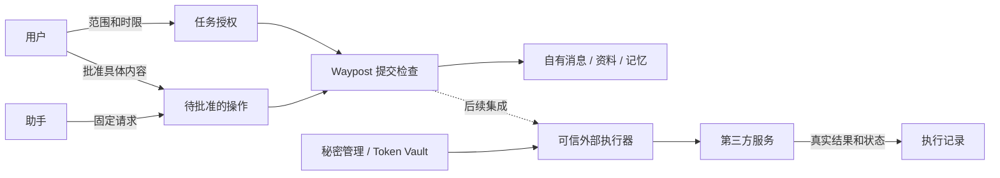

# Qoni、Auth0 与 Waypost 的下一步

研究日期：2026-10-13。本文阅读 Qoni、Auth0 的官方产品页与技术文档，并对照 Waypost 当前源码。第三方产品没有通过账户、SDK 或真实交易独立验证；官网示意、Beta、Early Access 和 Roadmap 分别标明。下文的 Waypost 产品方案是建议，不是已实现功能、确定规范或新的安全承诺。

Waypost 最值得吸收的是一条可检查的授权链：**谁把什么资料和操作交给哪个助手、为了哪件事、有效多久，最后发生了什么。** 当前实现已经有身份、资源权限、撤销和可靠提交。近期应把这些能力变成用户看得懂的短期任务授权、具体内容审批和操作记录；外部账号与支付另需可信执行器。

## 1. 先核对用户提供的说法

| 说法 | 官方资料能确认什么 | 应保留的边界 |
|---|---|---|
| Qoni 是 Personal Agent 托管基础设施 | 官方 Personal Agent 指南组合 GenAuth、Web Agent、GUMem，涵盖身份、浏览器动作和记忆。 | 是厂商描述；本次没有验证托管运行时。[Personal Agent](https://docs.qoni.ai/guides/personal-agent) |
| 给 Agent 一张工牌，身份与权限分开 | 官网提出独立 Agent 身份、绑定真人；技术文档中的模板、Owner/Sponsor、注册治理整体标为 **Roadmap**。 | 概念清晰不等于所有治理接口已稳定开放。[GenAuth 产品页](https://qoni.ai/genauth)、[Agent identity model](https://docs.qoni.ai/genauth/agent-identity/b1-agent-identity-model) |
| 按事务、按时间临时借权 | Delegate Token 文档标为 **Beta**，有范围与 60–86400 秒有效期；个人指南展示 30 分钟授权。 | 三方权限交集和多跳只减权章节单独标为 **Roadmap**，不能整体当作已上线保证。[Delegate Token](https://docs.qoni.ai/genauth/agent-identity/b3-delegate-token-attenuation) |
| 随时收回，每一步可审计 | 撤销文档明确：停用 AccessKey 立即停止新签发；**没有按 grant_id 撤销单个已签发 grant 的 API**。即时阻断已有 token 要由自有资源侧实现 deny list。 | 官网的“小于一秒撤销”示意不能概括所有已有令牌；完整 Agent kill switch 是 Roadmap。[Revocation](https://docs.qoni.ai/genauth/agent-identity/e5-revocation-and-emergency) |
| Agent 有邮箱和手机号，可自行注册 | 官网宣称邮箱与手机号；个人指南有创建 Agent 邮箱、绑定用户、读取验证码的流程。 | 未验证手机号供应、地区覆盖、外站是否接受注册；Waypost 的内部信箱也不是互联网邮箱。[GenAuth 产品页](https://qoni.ai/genauth)、[Personal Agent](https://docs.qoni.ai/guides/personal-agent) |
| Agent 碰不到支付卡号 | 个人指南称：GenAuth 加密保存卡片，批准后由 Web Agent runtime 直接填表，完整卡号不进入模型上下文、事件、截图或日志。首次提交卡片会经过应用服务器。 | 这是受控执行路径的厂商契约，**不是服务器或浏览器进程都无法接触明文**；本次未做泄露测试。[Personal Agent 的支付与敏感字段说明](https://docs.qoni.ai/guides/personal-agent) |
| Auth0 提供 Token Vault、细粒度权限、人工审批 | 官方分别提供 Token Vault、FGA 和 CIBA/RAR 文档。 | 这些是分别集成的能力；不能认为存了 token 就自动按每笔交易审批。[Token Vault](https://auth0.com/docs/secure/call-apis-on-users-behalf/token-vault)、[FGA for Agents](https://docs.fga.dev/modeling/agents)、[CIBA](https://auth0.com/docs/get-started/authentication-and-authorization-flow/client-initiated-backchannel-authentication-flow) |

谢扬与 Fellou、Eazo、Qoni 的完整创始人经历，在本次查阅的一手产品资料中未完成交叉核实。本文不将人物经历作为架构依据。

## 2. 四种能力不能混为一个保证

**身份**回答“是谁在执行”。**授权**回答“这次可以做什么”。**审批**回答“这个具体动作是否得到人同意”。**秘密使用**回答“谁拿着凭据实际执行”。系统还需记录实际结果，才形成完整链条。

Qoni 的同意文档区分用户现场授权、组织预先授权、运行时异步审批。后者的通用 GenAuth 接口仍标为 Roadmap；个人购物指南中的 Web Agent confirmation 是另一项具体运行时交互，不能据此断言通用 CIBA 能力已经开放。[Consent and approval](https://docs.qoni.ai/genauth/agent-identity/b4-consent-and-approval)、[Async authorization](https://docs.qoni.ai/genauth/agent-identity/e4-async-authorization)

Qoni 的审计文档以服务器生成的 grant_id/audit_id 关联签发、交换和访问；业务资源服务仍须把经过验证的主体与审计 ID 记录到自己的日志，链条才跨过 API 边界。技术页还说明其 access token 的 act 是扩展结构；实现时应按实际 claim 契约解析，不能从官网示意猜字段含义。[Audit chain](https://docs.qoni.ai/genauth/agent-identity/b6-audit-chain)、[Delegate Token claims](https://docs.qoni.ai/genauth/agent-identity/b3-delegate-token-attenuation)

Auth0 Token Vault 保存外部提供方的 token，应用通过交换获得外部 **access token**，然后自行调用 API。它隔离和管理长期外部凭据；应用后端仍持有短期访问令牌。要让 LLM 看不到令牌，须由应用把交换与调用放进受信工具后端，避免令牌进入 prompt、工具响应与日志。[Token Vault](https://auth0.com/docs/secure/call-apis-on-users-behalf/token-vault)

Token Vault 的 access-token exchange 文档将请求缩小 scopes 的参数标为 **Early Access**；省略时返回原连接授权的全部 scopes。因此“短期 token”不能自动推导出“这件事的最小权限”。Privileged Worker exchange 还允许经过专门配置的高权限服务在无活跃用户会话时调用；它是可信服务边界，不适合直接交给模型控制。[Access Token Exchange](https://auth0.com/docs/secure/call-apis-on-users-behalf/token-vault/access-token-exchange-with-token-vault)、[Privileged Worker Exchange](https://auth0.com/docs/secure/call-apis-on-users-behalf/token-vault/privileged-worker-token-exchange-with-token-vault)

CIBA 把审批移到用户的另一个设备或邮箱；RAR 可以携带金额、收款方、操作对象等详情。批准后应用收到 access token。Auth0 明确只检查 RAR 的 type 是否被该 API 允许，**具体参数是否合法由资源服务器验证**。每次 CIBA 都需要新决策，仍不代表发出的 bearer 自动只能使用一次；一次性执行需要业务服务消费批准记录。[User Authorization with CIBA](https://auth0.com/docs/get-started/authentication-and-authorization-flow/client-initiated-backchannel-authentication-flow/user-authorization-with-ciba)

FGA 的任务授权范例按任务、工具、资源、时间和 Agent 绑定作检查，调用次数与当前时间作为检查上下文传入。对 Waypost 的启发是“在执行处校验这次任务”，不能把外部 FGA 检查结果本身当作并发安全的一次性消费凭据。[Task-Based Authorization](https://docs.fga.dev/modeling/agents/task-based-authorization)

## 3. Waypost 的当前位置

下表的“已有”来自源码阅读，描述当前分支的行为；本次研究没有重新运行测试或验证线上部署。

| 用户需要 | Waypost 已有 | 实际缺口 |
|---|---|---|
| 每个助手可辨认 | Actor 是稳定参与方；Consumer 区分设备或读取视图；token 绑定 Space/Actor/Consumer。 | 缺任务归属、接入来源说明和独立的人工批准记录。[身份迁移](../../migrations/0001_identity_mailbox.sql)、[绑定完整性](../../migrations/0006_grant_integrity.sql) |
| 我的资料只给我的助手 | Space 用户管理凭据、按空间的资源关系、独立加密上下文。 | 是逻辑权限隔离；同一部署运行时仍能解密，不是每用户独立数据库或对运营者的端到端加密。[用户管理](../../migrations/0008_user_administration.sql)、[安全说明](../security.md) |
| 只借给它需要的权限 | scopes、recipient/collection/blob grants；token 支持 expires_at 与撤销。 | 到期字段可为空；Dashboard 接入默认发六项权限且未设置到期。无 task_id、次数或单次操作约束。[Token 签发](../../src/service/admin.rs)、[默认接入](../../dashboard/app.js) |
| 权限收回后不能继续提交 | authenticate 与 authority_guard 检查 token、Actor、Consumer 版本、禁用、到期、撤销；发布在提交批次再检查。 | 当前检查限 Waypost 自有服务；不能阻止已下载数据被继续使用，也不能撤回外部 SaaS 已执行的动作。[领域认证与提交 guard](../../src/service/mod.rs) |
| 我批准的是这份内容 | Submission 有 JCS 请求指纹、幂等键与 committed 状态。 | 请求指纹证明重试内容一致，不证明人工同意；缺 Approval 与具体操作参数绑定。[发信](../../src/service/mailbox.rs)、[JSON 规范化](../../src/json.rs) |
| 看得见授权与操作经过 | Submission、历史回执、privacy_audit。 | privacy_audit 记录过滤命中，不是权限审计；received/processed 是客户端报告的阶段，不证明付款、任务或第三方操作成功。[回执](../../src/service/receipts.rs)、[隐私迁移](../../migrations/0004_privacy.sql) |
| 秘密不进入模型 | HPKE 保护存储副本，私钥按 Space 派生；服务授权读取时解密。 | 当前没有第三方秘密库、OAuth token exchange、受信执行代理或卡号注入。HPKE 不会令授权读取的明文自动对 Agent 隐藏。[加密实现](../../src/service/encryption.rs)、[保护范围](../security.md) |

应保留已有的提交 guard 和逻辑空间边界。引入外部身份供应商时，将经过验证的外部主体明确映射到本地 Space/Actor，外部登录成功不能直接变成本地管理权或跨空间授权。

## 4. 产品定位：让授权跟着具体交接走

建议将 Waypost 的下一步定位为：**不同助手之间交接消息、资料和记忆时，用户能限定范围、批准重要交接，并查到每次交接的依据和结果。**

Qoni 的产品范围包含身份、受控浏览器执行与记忆；Auth0 提供应用可接入的身份和授权设施。Waypost 当前直接掌握的是自身消息、资料、记忆的提交与读取路径，因此最容易做出可信承诺的是这些路径上的任务授权与审计。这是根据三者边界作出的产品判断，非第三方功能排名。[Qoni Personal Agent](https://docs.qoni.ai/guides/personal-agent)、[Auth0 Agent Authorization](https://docs.fga.dev/modeling/agents)

网站可以用一个具体场景解释方向：研究助手只读指定资料，整理好后等待用户批准，交给写作助手；用户可看到谁读取、谁批准、交出了哪些固定版本。当前网站若展示此场景，须标为提案，不能宣传任务批准已经实现。

## 5. 建议优先级

| 顺序 | 改进 | 用户得到什么 | 完成时要证明什么 |
|---|---|---|---|
| P0 | 最小权限接入与明确到期 | 创建身份后，先选择收信、只读资料或发布等具体用途；每项显示范围和结束时间。 | 新接入没有隐藏的全套权限；短期凭据不能静默续期；长期同步须由用户明确选择。 |
| P1 | 短期任务授权 | 授权“整理集合 A，交给助手 B，30 分钟内有效”，可查看与立即撤销。 | Agent 换 task_id、资源、Space、操作或过期后均不能扩大权限；提交瞬间再次检查。 |
| P1 | 绑定请求指纹的一次性审批 | 用户预览收件人、正文、附件版本后只批准这一份交接。 | 内容改变需重批；并发与重试只产生同一笔提交；拒绝、超时、撤销不执行。 |
| P1 | 可查询的授权与操作审计 | 一条时间线说明谁授权、谁批准、谁执行、执行什么和结果。 | 授权事件、读取、发布、拒绝和撤销可关联；不会把敏感正文或 token 复制进审计。 |
| P2 | 按需接入 IdP/FGA/CIBA | 多用户登录与企业身份可接入现有系统，关键决策仍由 Waypost 执行处确认。 | 不信任 caller 自报 user/agent/grant；验证 issuer/audience/签名/过期与本地绑定；可用性失败有明确行为。 |
| P2 | 外部秘密使用代理 | 在有真实需求时，助手调用具名外部动作，长期秘密留在可信执行器。 | 执行器限制目的地、动作与资源；秘密不经模型响应、日志或任意网络转发；第三方结果可以对账。 |

### P0：先改接入体验

“工牌”应先显示身份，再单独显示权限。创建 Actor/Consumer 不自动代表给齐权限。预设用途是可解释的起点；页面要显示具体收件人、集合、操作、时限与最终授权。

接入资料不应直接把管理 bearer、用户管理凭据或加密根密钥交给 Agent。Agent 的认证凭据由宿主安全配置持有，模型能查到的是权限摘要。当前 describe 可以作为基础，但应补到期、授权来源与任务范围；有权限读写自己的集合时，也应如实显示。

### P1：任务授权是新的权威记录

建议引入独立 TaskGrant，保存服务器生成的 grant_id、Space、已认证批准主体、Actor/Consumer、任务说明、允许操作与资源、有效期、撤销版本。任务名称是说明文字，真正的权限必须是可校验的结构化字段。

有效权限取用户可授予范围、接入权限上限、任务范围、具体操作批准的交集。Agent 不能通过声明 task_id 获得权限；也不能靠已有的“拥有自己的集合”规则绕开更窄任务范围。创建、上传准备、读取和最终发布均须明确遵守任务约束。

一项任务可包含多次低风险读取。一次性批准针对某个具体提交，两者分开建模；否则“一次性 token”会误杀合法重试，或被误用成可反复执行的通行证。

### P1：批准必须和最终操作绑定

Approval 至少绑定 Space、任务授权、Actor/Consumer、操作、request_id、规范化请求指纹、正文/附件固定版本或内容摘要、目标资源、相关策略版本、有效期和批准人。预览应来自待执行的服务器记录，不能只显示 Agent 自己写的摘要。

处理隐私过滤时，预览与提交必须针对同一内容和策略版本；过滤策略或正文变化后重新预览和批准。附件不能靠可变文件名代替固定 blob_id 与完整性摘要。管理 Cookie 路径继续检查 CSRF，Agent 不能自批。

对 Waypost 自有写入，将“权限仍有效、批准未被消费、请求指纹一致、批准消费、业务提交”放进同一个带 guard 的事务批次。重试沿用同一 request_id，返回原结果；并发只能有一个提交赢家。批准等待期间不占数据库事务和对象租约，超时默认拒绝。

当前 Space owner credential 能证明本空间的管理身份，尚不足以区分同一凭据后的多个人。首版可明确记录空间凭据版本对应的批准来源；若产品要声称“某位具体用户批准”，应先建立可认证的人工主体，不能以页面输入的姓名充当身份。

### P1：把审计变成用户可读的记录

至少记录授权签发、缩小/撤销、批准/拒绝/超时、受保护资料读取、提交成功/失败。关联 Space、Actor、Consumer、grant/task/approval/submission/resource ID、版本、时间、决策原因与结果。ID 和批准主体来自服务器认证与权威记录，客户端的用途文字只作声明。

审计不保存 bearer、卡号、原始秘密、完整正文或任意模型上下文；用户只看到自己的空间，部署管理员按职责查看。保留期、分页、下载与错误事件限额要明确。先提供可查询的真实事件，不把“追加写入数据库”宣传成不可篡改审计。

## 6. 外部动作与秘密代理的执行边界

将来若要发互联网邮件、注册账号或付款，需要一个可信执行器。Waypost 可以保存意图、批准与结果引用；执行器须重新确认具体参数和授权，使用外部秘密调用目标系统，并回传可核对的证据。

此图为建议，不描述已经实现的外部能力。

外部执行器宜先提供一个窄动作，例如“用已连接的邮箱向指定地址发送已批准草稿”。限制 provider、账户、目的地址、动作与资源；阻止任意 URL 代理、跨主机重定向泄露和秘密回显。模型获得结果引用和必要业务数据，长期凭据与短期 access token 留在受信执行进程。

审批通过不等于第三方已经成功执行。Waypost 的数据库事务也不能覆盖第三方 API：外部执行要使用其幂等键，持久保存尝试记录；请求超时或响应丢失时先查第三方状态，无法确认就显示“结果未知”，不能一律重新发送或付款。若第三方不提供可靠幂等/查询，产品须约束可自动执行的范围。

为 Agent 申请邮箱或手机号还涉及账号生命周期、验证码访问与外站条款。先选择一个供应商和用户场景再做连接器，不能把普通邮箱或短信权限混入 Waypost 默认接入。支付应最后评估：卡片加密保存和批准按钮都不能替代受控执行、准确金额绑定与交易对账。

## 7. 一个可落地的用户流程

用户让研究助手整理“旅行资料”集合 A，再把结果交给写作助手 B。以下是目标体验，当前可完成基础收发，任务授权与批准步骤仍待实现。

1. 用户登录自己的 Space，选研究助手与资料集合 A，创建 30 分钟的任务授权：只读 A，允许提交结果给 B，不提供其他集合的读写权限。
2. 研究助手通过可信宿主取得短期任务凭据，读取指定资料。页面显示实际授权、结束时间与读取事件，普通有界读取不逐次打断用户。
3. 助手提交交接草稿。服务器冻结收件人、正文、附件版本和隐私策略版本，建立待批准记录；此时尚未向 B 发布。
4. 用户预览将发出的内容，批准“仅发送这一份”。改收件人、正文或附件后，原批准不再匹配。
5. Waypost 在提交批次检查权限、期限和批准，消费批准并发布。网络重试沿用同一 request_id，返回原提交结果。
6. 写作助手 B 在自己的授权视图中收到内容，回执记录 received/processed；用户分别看到“已发布”“客户端报告已接收/处理”。系统不把这些状态显示成“写作任务成功”。
7. 用户随时撤销任务授权；后续读取和未提交的发布被拒绝。已合法读取的副本与已发布的内容不因撤销自动消失。

这个流程能直接检验产品方向：用户是否更容易只借出必要资料，是否看得懂批准范围，是否能撤销，并查清实际交接。先把它做好，再决定是否需要外部身份设施或受控浏览器。

## 8. 进入实现前要确认的契约

首轮设计应明确 TaskGrant、Approval 和 OperationAudit 的状态及 ID 关系，并补针对并发、撤销竞态和重试的性质契约：另一 Space/Actor/Consumer 不可复用授权；过期、撤销、拒绝和超时均不提交；批准参数改变不执行；同一批准并发消费只提交一次；已提交的同一请求恢复原结果；拒绝事件不泄露其他用户内容。

研究不要求现在引入 Auth0、Qoni、支付或新的外部账户。依据是现有代码边界与已核实文档；第三方发布状态及接口会变化，实际集成前需再次确认，尤其 Qoni 的 Roadmap 项、Auth0 的 Early Access downscoping 与 CIBA 所需方案。[Qoni Revocation](https://docs.qoni.ai/genauth/agent-identity/e5-revocation-and-emergency)、[Auth0 Token Vault Exchange](https://auth0.com/docs/secure/call-apis-on-users-behalf/token-vault/access-token-exchange-with-token-vault)、[Auth0 CIBA 配置条件](https://auth0.com/docs/get-started/authentication-and-authorization-flow/client-initiated-backchannel-authentication-flow)
