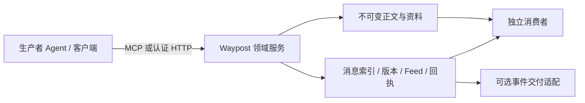
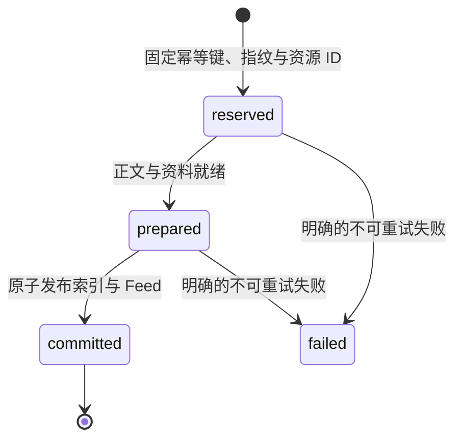
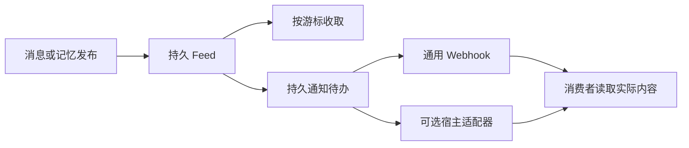
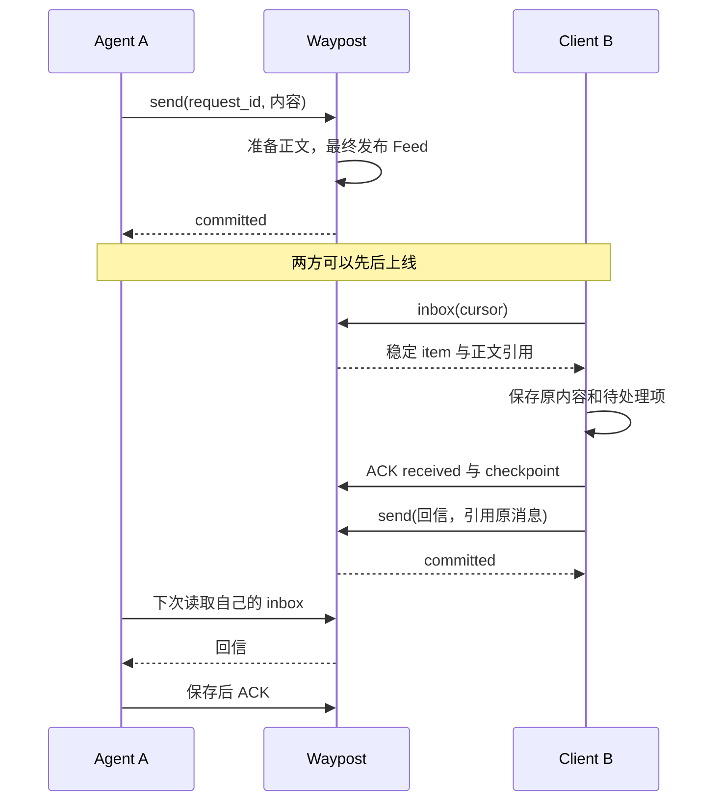

# RFC-0001：Waypost 异步信箱与记忆交换协议

| 项目 | 值 |
|---|---|
| 状态 | Draft / implementation baseline |
| 草案版本 | 0.1.0 |
| 应用协议版本 | `0.1` |
| 日期 | 2026-10-11 |
| 规范范围 | 身份、异步消息、独立消费、资料对象、来源记忆和可选事件 |
| 首个部署方案 | Cloudflare Workers + D1 + R2 Standard |
| 配套 | [术语](../../CONTEXT.md)、[性质与验证计划](0001-properties.md)、[研究依据](../research/0001-protocol-precedents.md) |

## 1. 摘要与规范约定

Waypost 为用户、个人 Agent 和客户端提供一个可独立使用的异步信箱。生产者发布消息与记忆资料，消费者在之后读取并报告收取或处理结果。双方不必同时在线。

本 RFC 定义可以直接据以实施的 v0.1 行为。公开接口、通用 Skill 和协议格式属于同一项目；任何兼容客户端都可使用相同接口。模型执行、业务任务调度、内容理解和记忆语义合并由参与方负责。

关键词 `MUST`、`MUST NOT`、`SHOULD`、`SHOULD NOT`、`MAY` 按 [RFC 2119](https://www.rfc-editor.org/rfc/rfc2119) 和 [RFC 8174](https://www.rfc-editor.org/rfc/rfc8174) 理解。只有大写关键词表达该级别的规范要求。

本规范的操作语义优先于示例、部署建议和外部研究笔记。配套性质用于验证这些语义；发现冲突时必须先修正规范，不能靠实现静默选择。

本文是实施基线，不代表服务已运行、第三方宿主已兼容或存在官方在线地址。

## 2. 动机、目标与非目标

### 2.1 动机

个人用户可能有多个 Agent：它们分别持有会话、结果、待办线索和记忆，用户需要反复打开不同入口、搬运上下文。执行方和接收方不同时在线时，单次工具返回或临时通知不能提供连续记录。

Waypost 提供稳定的身份、持久内容与公开交换协议。用户可以保留原有助手，更换消费者或执行环境时仍可读取消息和携带记忆资料。

### 2.2 目标

1. 已发布内容具有稳定身份，可查询、可恢复、可重复收取。
2. 同一写入的重传不会形成第二次发布；内容冲突有明确结果。
3. 每个消费者独立同步和确认，读取不删除其他消费者的数据。
4. 来源记忆支持完整快照、增量更新、删除标记与可携带导出。
5. MCP 与认证 HTTP 接口映射相同的领域操作。
6. 事件通知是可选能力，持久读取始终是恢复依据。
7. 权限和数据模型不依赖特定模型、宿主、应用或云平台。

### 2.3 非目标

v0.1 不实现 Agent 运行时托管、跨服务器联邦、自动业务编排、语义记忆合并、模型推理、团队组织系统或公开 Agent 市场。端到端加密和任意第三方平台的内部记忆抽取另行设计。

v0.1 的控制面服务一个自托管实例的所有者，可以管理多个隔离 Space。面向公众的注册、计费与多所有者账号系统不属于本 RFC，但业务接口始终执行空间隔离。

## 3. 设计原则与先例

| 先例 | 借鉴 | 本项目自己的边界 |
|---|---|---|
| Matrix MSC | 动机、精确操作、失败、替代方案与兼容说明 | 不采用房间、联邦或其治理流程 |
| Matrix Client-Server | 请求重传标识与增量同步位置分开 | 自己定义稳定参与者范围与独立消费者 |
| CloudEvents 1.0.2 | 可移植的事件身份和信封格式 | 身份认证、游标与记忆一致性由本 RFC 定义 |
| Standard Webhooks | 稳定事件 ID、签名与交付语义 | 通知回执不代表输入处理或业务动作完成 |
| MCP Events | 能力发现、订阅与可选通知适配 | 特定宿主的后台行为不进入通用核心 |

具体来源、核对版本和差异见[研究依据](../research/0001-protocol-precedents.md)。本 RFC 不宣称实现 Matrix 协议或一个已被其他宿主普遍支持的事件扩展。

## 4. 领域、身份与授权

### 4.1 数据边界



所有业务对象属于一个 Space。服务生成稳定对象 ID；它们是不可解释的字符串，客户端不得依赖排序、前缀或从 ID 推导所有者。

公共 ID 字段允许 ASCII 字母、数字、`_`、`-`，长度 1–96。示例使用简短 ID；实现 SHOULD 使用具有足够唯一性的随机标识。`request_id` 另允许 `.`、`:`，长度 1–128，不用作文件路径。

### 4.2 参与者与消费者

- Actor 表示用户、Agent 或客户端身份；显示名称不是身份凭据。
- Principal 是认证得到的调用上下文：`space_id`、`actor_id`、权限、授权代次。
- Consumer 是稳定的收取身份：所属 Actor、视图、固定过滤条件和视图版本。
- 同一 Actor 的多个安装 MAY 使用不同 Consumer；它们的回执与检查点独立。
- 令牌轮换 MUST NOT 改变 Actor、Consumer 或既有提交的幂等范围。

Space 有一个默认收件 Actor。消息省略 `recipient_ids` 时发给它；这个默认身份在 v0.1 中不允许原地更换。普通客户端可以自行选择接收与处理方式。

### 4.3 权限

| 权限 | 默认资源范围 |
|---|---|
| `message.send` | 允许的收件 Actor 集合，缺省仅空间默认收件人 |
| `message.read` | 当前 Actor 收到的消息与自己发布的消息 |
| `space.observe` | 所有者显式授予的空间消息观察范围 |
| `receipt.write` | 当前主体绑定的 Consumer |
| `memory.write` | 当前 Actor 所有的 Collection |
| `memory.read` | 所有者授予的 Collection 集合 |
| `blob.write` | 当前空间、当前提交范围的暂存上传 |
| `event.subscribe` | 主体本来可以读取的资源与过滤范围 |

生产者、Space、来源 Actor 和 Consumer 身份 MUST 来自已验证凭据。正文、MCP `clientInfo`、CloudEvents `source` 或显示名称不能扩大权限。

每次读取、写入、查询状态、附件访问和发布都重新检查当前授权。失效或已撤销凭据即使带着曾成功的幂等键，也不得取得旧结果。

撤销以元数据提交为边界，之后的新操作不能使用旧权限；已经完成发布或已发出的响应字节不能被撤回。等待上传的发布仍需在最终提交点通过授权检查。

不可读对象统一返回 `NOT_FOUND`，不通过错误区别“另一个空间存在”和“不存在”。已知的本空间能力不足可以返回 `FORBIDDEN`。

### 4.4 Consumer 视图

`inbox` 视图：读取投递给所属 Actor 的消息、向其公开的回执变化，以及有读取授权的记忆变化。

`space_log` 视图：需要 `space.observe`，观察空间中的获准消息；记忆内容仍需独立的 `memory.read`。观察消息不授予修改来源记忆的权限。

过滤字段限于 `producer_ids`、`thread_ids`、`item_types`、`collection_ids`，值是去重后的集合。空列表表示不额外筛选。过滤不能扩大上述视图。

视图或权限发生变化时递增 Consumer 的 `view_revision`。旧游标返回 `CURSOR_SCOPE_CHANGED`，客户端以新的起点重同步并按对象 ID 去重。

## 5. 版本、编码与公共结果

### 5.1 版本分层

| 层 | v0.1 约定 |
|---|---|
| Waypost 应用 API | `0.1`；HTTP 路径 `/v0` |
| 消息记录格式 | `envelope_version: 1` |
| CloudEvents 格式 | `specversion: "1.0"`，参考文本为 1.0.2 |
| MCP 版本 | 由宿主与适配器协商，不由 Waypost API 版本推导 |
| 可选宿主事件 profile | 独立公布 capability，不隐含后台执行能力 |

请求使用 UTF-8 JSON，MUST 拒绝重复 JSON 对象键、非有限数字和 schema 未声明的请求字段。用户自定义内容限于明确的 `metadata` 对象，不可覆盖服务字段。

同一语义请求的指纹采用 RFC 8785 JCS 后的 SHA-256。收件人集合先排序，默认值在首次保留提交时固定；附件列表、正文和 metadata 的实际内容保留。客户端时间不参与 Feed 排序。

### 5.2 结果格式

```json
{
  "ok": true,
  "request_id": "req_001",
  "data": {
    "submission_state": "committed",
    "resource_id": "msg_001"
  }
}
```

```json
{
  "ok": false,
  "request_id": "req_001",
  "error": {
    "code": "IDEMPOTENCY_CONFLICT",
    "message": "The request ID was already used with different content.",
    "retryable": false,
    "details": {}
  }
}
```

所有领域操作使用上述结果语义。MCP 适配器按实际协商的 SDK 结果格式承载它，并把失败明确标为工具失败；JSON-RPC 解析、未知方法等传输错误仍使用 MCP 规范的错误格式。

未知响应扩展字段 MAY 忽略，未知必需版本或 item 类型必须报告不支持，不能把它当作已处理并越过检查点。

### 5.3 默认资源限制

以下是首版的应用限制，可通过 `describe` 公布更小部署值；客户端必须遵循实际值。

| 资源 | 默认上限 |
|---|---|
| 普通 JSON 请求 / 消息信封 | 64 KiB UTF-8 字节 |
| 单个 Blob | 8 MiB |
| 每封消息的附件 | 16 个 |
| 收件人 | 16 个，同一 Space |
| 单页 Feed / 记忆条目 | 100 个，默认 50 |
| 单次 ACK | 20 个 item |
| 内联记忆发布 | 500 个 upsert + delete 条目 |
| manifest Blob 记忆发布 | 10,000 个 upsert + delete 条目，仍受 Blob 字节限制 |
| Collection 当前条目 | 10,000 个，包括 active items 与当前 Tombstone |
| 暂存上传期限 | 24 小时 |

大快照通过预先封存的 manifest Blob 发布，避免把全部条目装入 MCP 调用。更大的集合在 v0.1 中拆成独立 Collection，不隐藏截断。

`visible_seq` 在协议中为十进制字符串，避免 JSON 数值精度问题；`revision` 是 0 到 `2^53-1` 的整数。达到上限返回 `RESOURCE_LIMIT`，不回绕。

## 6. 消息契约

### 6.1 发送请求

```json
{
  "request_id": "req_report_001",
  "recipient_ids": ["actor_user"],
  "thread_id": null,
  "in_reply_to": null,
  "kind": "result",
  "subject": "研究资料已整理",
  "body": {
    "text": "已整理三个方案，附件包含完整资料。"
  },
  "source": {
    "native_thread_id": "external_thread_01"
  },
  "attachment_ids": [],
  "metadata": {}
}
```

| 字段 | 规则 |
|---|---|
| `request_id` | 必填，当前写操作的稳定幂等标识 |
| `recipient_ids` | 可省略；显式提供时必须非空、唯一、获准且同空间 |
| `thread_id` | 空值创建新会话；已有 ID 必须可用且当前主体有权参与 |
| `in_reply_to` | 可空；非空时必须是可读原消息，且与 `thread_id` 一致 |
| `kind` | `info`、`question`、`result`、`todo_suggestion`、`memory_notice`、`processing_result` |
| `subject` | 必填，非空字符串，最多 256 UTF-8 字节 |
| `body.text` | 必填字符串，问题的选项可放 `body.options`，最多 20 个字符串 |
| `source` | 可选来源引用，仅允许 `native_thread_id`、`native_message_id`、`url` |
| `attachment_ids` | 封存且可用于当前投递范围的 Blob ID 列表 |
| `metadata` | 可选自定义 JSON 对象，随信封大小限制，不参与授权 |

对回复请求，收件人 MUST 显式提供；不存在“服务根据一段自然语言猜收件人”的行为。仅提供 `in_reply_to` 而未提供 `thread_id` 时，服务使用原消息的会话。

新收件人加入已有会话，必须通过所有者的控制面授权；`message.send` 本身不能让新增收件人自动读取会话历史。

### 6.2 已发布消息

服务补齐 `message_id`、`space_id`、`producer_id`、`thread_id`、`committed_at`、`envelope_version`，以及最终固定的收件人和附件列表。`committed_at` 是服务发布时间，不等于来源发生时间。

消息正文与上述身份字段发布后不可变。补充、更正或撤回意图通过引用原消息的新消息表达；这不自动撤销任何外部执行。

一个消息引用的正文与全部附件 MUST 在发布前可读取并封存。单个附件未就绪时返回 `BLOB_NOT_SEALED`，整个消息不得部分发布。

### 6.3 状态与幂等

幂等键为 `(space_id, producer_id, operation, request_id)`。它不包含当前 token ID。指纹相同的重复调用返回原稳定结果；不同内容返回 `IDEMPOTENCY_CONFLICT`。



网络异常本身不是 `failed` 事实。可重试的暂时失败保留 `reserved` 或 `prepared`，通过同一个请求恢复。并发重试不能获得两个资源 ID。

schema、权限和资料引用的前置校验失败不占用新的幂等键。保留之后被确定无法以原内容发布的失败，例如记忆 CAS 冲突或无效 manifest，记录为 failed 并返回原错误；暂时存储故障以及凭据当前不可用不能被伪装为永久业务失败。授权恢复后仍须先核实原键。

同指纹的并发请求正在执行时，可返回 `SUBMISSION_PENDING` 与原资源/提交标识；不返回保存成功。已发布后再次调用必须返回同一 `resource_id` 和 `committed_at`，而不是另一封“相同内容”的消息。

## 7. 持久发布与恢复

### 7.1 首个存储方案

- R2：不可变消息正文、封存 Blob、记忆 manifest 和导出资料。
- D1：身份与授权、提交保留、消息索引、Consumer、Feed、回执、Collection、Revision。
- Workers：认证、schema 校验、领域操作、MCP / HTTP 适配和可选通知。

R2 与 D1 之间没有跨服务原子事务。D1 的最终发布提交是业务可见性的线性化点。

### 7.2 发布算法约束

1. 验证当前授权和请求格式。
2. 保留幂等键、规范化指纹、稳定资源 ID 与服务时间。
3. 在服务控制的不可变键准备正文或版本 manifest，核验资料引用。
4. 在一笔元数据事务中完成提交状态、业务索引、版本变更和 Feed 项；发布序号在此时生成。
5. 事务提交后返回 `committed`。如果响应丢失，同幂等键查询或重试返回第 4 步的原结果。

`visible_seq` MUST NOT 在上传暂存时分配；来源时间和请求创建顺序也不能替代发布顺序。

授权代次或 Consumer/Collection 状态在等待上传期间改变时，最终发布必须重新校验。重新校验与元数据写入必须防止并发撤销穿透；内存中的旧授权结果不是提交授权。

### 7.3 元数据原子性

每次发布要么同时写入业务记录、提交结果与 Feed，要么没有任何可见副作用。记忆 CAS 未命中时，既不能增加版本，也不能追加 Feed。

D1 适配器不得把 SQL 执行成功当作条件更新成功。必须以受同一提交条件保护的数据库操作实现 `Commit`；0 行命中的更新不能随后无条件插入版本或事件。具体 SQL 由实现决定，但必须通过并发和故障契约测试。

### 7.4 故障矩阵

| 失败点 | 可见结果 | 恢复 |
|---|---|---|
| 保留提交前失败 | 无成功结果 | 同 ID 正常重试 |
| 保留后、正文未就绪 | 未发布 | 沿原提交准备内容 |
| R2 成功、D1 失败 | 内容不可见于 Feed | 沿原提交发布或清理暂存 |
| D1 成功、响应丢失 | 已发布 | 同 ID 返回原结果 |
| Consumer 下载后崩溃、未 ACK | 内容仍在 | 重读并按 item ID 去重 |
| 收取已确认、业务处理失败 | 收取记录保留 | Consumer 从自身待处理队列恢复 |

已发布记录不依赖 Worker 内存、连接或 `waitUntil` 生存。暂存清理只能删除未封存、无发布引用且没有有效提交租约的资料。

## 8. 独立收取、游标与回执

### 8.1 Feed Item

Feed 项包含：`item_id`、`space_id`、`visible_seq`、`item_type`、`resource_id`、`resource_version`、`producer_id`、`recipient_ids`、`thread_id`、`committed_at`。

`item_type` 为 `message`、`memory_revision` 或 `receipt`。消息面向其收件范围；回执面向原 Feed 项的生产者和具有观察授权的主体；记忆变化仅对可读取该 Collection 的消费者可见。

每个 Feed Item 同时有不可变的类型专属 `data`：

| item_type | resource_id / version | data 必需字段 |
|---|---|---|
| message | message_id / 1 | message_id、subject、kind |
| memory_revision | collection_id / revision | collection_id、revision、parent_revision、manifest_blob_id |
| receipt | receipt_id / 该回执的状态版本 | subject_item_id、subject_resource_id、consumer_id、actor_id、stage、updated_at |

回执 data 描述这次推进时的阶段，不在后来读取时改成另一阶段。生产者可以据此知道哪个消费者收取了哪个输入；不必依靠缺少定义的 receipt.get。回执状态版本只在真正推进时增加。

可见性等于 Space、主体授权、Consumer 视图与固定过滤条件的交集。`space_log` 不自动暴露未授权记忆。

### 8.2 读取

```json
{
  "consumer_id": "consumer_a",
  "cursor": null,
  "limit": 50
}
```

```json
{
  "ok": true,
  "request_id": "read_001",
  "data": {
    "items": [
      {
        "item_id": "feed_001",
        "space_id": "space_001",
        "visible_seq": "1",
        "item_type": "message",
        "resource_id": "msg_001",
        "resource_version": 1,
        "producer_id": "actor_agent_a",
        "recipient_ids": ["actor_user"],
        "thread_id": "thread_001",
        "committed_at": "2026-10-11T10:00:00Z",
        "data": {
          "message_id": "msg_001",
          "subject": "研究资料已整理",
          "kind": "result"
        }
      }
    ],
    "next_cursor": "opaque_cursor",
    "has_more": false
  }
}
```

非写入操作的响应 request_id 是服务生成的跟踪标识，不是新的幂等提交。`cursor: null` 从保留历史的起点开始，不能默认跳到“现在”。

读取按 `visible_seq` 升序、排他性位置返回。`has_more` 只表示响应取样时尚有符合范围的保留项，不承诺之后没有新发布。

游标是经完整性保护的 opaque 值，绑定协议、Space、Actor、Consumer、`view_revision`、规范化 filter 指纹与位置。客户端不得自行增减位置。游标被修改返回 `INVALID_CURSOR`；用于其他 Consumer 返回 `CURSOR_SCOPE_CHANGED`。

游标同时绑定实际 scope/resource-grants 的指纹。同 Consumer 换用权限不同的凭据时需要重新同步；同权限的令牌轮换保持游标有效，不把 token ID 当授权指纹。

每页返回的游标只能越过已返回的可见项及确定不可见的项；不能越过仍在准备但未来以较低序号补入的项。实现避免这种情况的主要规则是最终提交才分配序号。

### 8.3 ACK 与检查点

```json
{
  "request_id": "ack_001",
  "consumer_id": "consumer_a",
  "items": [
    { "item_id": "feed_001", "stage": "received" }
  ],
  "checkpoint_cursor": "opaque_cursor"
}
```

`received` 是当前 Consumer 声明已经将输入可靠保存；`processed` 是其声明已处理该输入。服务不能据此证明外部动作成功。服务只验证主体、资源、Consumer、范围和回执转换。

回执按 `(space_id, consumer_id, item_id)` 独立保存，并单调推进 `none → received → processed`。乱序收到 `processed` 可同时建立该消费者的 `received`，之后迟到的 `received` 不能回退它。

重复同阶段 ACK 成功返回当前状态，不产生第二条回执变化事件。只有状态真正推进才发布 `receipt` Feed 项。确认一个回执 Feed 项本身不再产生回执 Feed 项，避免确认循环。

`checkpoint_cursor` 可空；非空时记录消费者声明已经可靠保存的收取位置。它不要求此前每项都 `processed`，也不作为其他 Consumer 的位置。

检查点按 Consumer、view_revision 与有效授权指纹分别保存。同一固定视图只能前进；视图变更后的起点是新的检查点，不拿旧视图的较大位置阻止新授权历史的补收。

客户端 MUST 在持久保存整页内容与待处理记录后提交该检查点。服务确认检查点是一个声明，不代表服务能证明客户端实际的本机持久性。

一次 ACK 的回执、检查点与相应变化记录原子提交。检查点只允许前进；较旧但合法的检查点为无副作用成功，不回退进度。

### 8.4 保留与重同步

v0.1 默认不自动裁剪已发布消息、版本和 Feed，不因 ACK 删除内容。初始部署保留完整增量记录，同时公布容量限额；满额时拒绝新写入，不静默丢旧信。

若部署启用了后续的保留策略，必须公布 `history_floor`；旧游标返回 `CURSOR_EXPIRED` 并提供明确重同步入口。v0.1 实现可以不提供裁剪能力，不能假装缺失历史仍可完整恢复。

重同步从保留内容重新建立视图，使用稳定 item/resource ID 去重。重同步不是执行外部操作的命令，业务副作用仍由消费者自己的去重和执行记录管理。

## 9. 资料上传与封存

### 9.1 上传协议

`blob.prepare` 请求：`request_id`、`content_type`、`size_bytes`、`sha256`、可选 `filename`。摘要是 64 位小写十六进制；大小是非负整数，受当前部署上限约束。零字节文件合法，使用空字节序列的真实 SHA-256。

响应：`upload_id`、`blob_id`、`upload_url`、`expires_at`、必须使用的请求头说明。服务生成对象键，调用方不得传入任意 bucket、路径或远程抓取地址。

v0.1 使用 `PUT /v0/uploads/{upload_id}/content`，原参与者凭据认证，直接流式接收文件。服务在有效上传范围内检查类型、实际字节数与 SHA-256；内容校验必须针对实际收到的字节，而非仅保存调用方声称的摘要。

Cloudflare 适配器 SHOULD 利用 R2 Put 的服务端 checksum 校验并流式写入，避免在 Worker 内缓冲或重新计算整份大文件。[R2 Workers API](https://developers.cloudflare.com/r2/api/workers/workers-api-reference/)

PUT 的成功回执说明指定字节已完整存储；它仍不是封存回执。若 R2 成功但上传 metadata 响应丢失，后续重复 PUT 或 commit 要核实实际对象，不能仅凭旧的 pending 状态认定文件不存在。

随后调用 `blob.commit`，携带 `request_id` 与 `upload_id`。文件校验成功且内容已可读后，原子地把 Blob 元数据标为 `sealed`，返回固定 `blob_id`、大小、类型和摘要。

commit 在原操作成功后同键重试返回原封存结果。过期规则针对尚未封存的上传；已封存资料不因原上传的 expires_at 到达而失效。

### 9.2 不可变性

上传对象从首次成功写入即按服务指定内容约束进行 create-only 写入；重复上传不能覆盖它。封存后新的 PUT 被拒绝，正在并发的迟到 PUT 也不能修改同键内容。

未封存上传的重复 PUT 若现存对象大小、类型和被验证的 SHA-256 与保留值一致，返回成功的 `already_uploaded: true`，不再次覆盖；否则返回 `UPLOAD_CONTENT_CONFLICT`。封存后的 PUT 返回 `UPLOAD_SEALED`。R2 条件写返回 null 只表示条件未满足，必须核实现存对象后选择上述结果，不能直接当作已成功写入。

暂存上传地址在本方案中不是无认证的永久桶地址。v0.1 不直接公开 R2 / S3 管理密钥，也不必引入可重复使用的预签名 PUT。以后采用这种方式时需另定义封存复制、校验、到期与撤销边界。

Blob 读取必须检查当前权限：拥有者可读取自己的封存 Blob；消息或记忆的获准读者可读取其中明确引用的 Blob。拥有读取权不自动获得向其他收件人重新引用的权利；重引用需要拥有该 Blob 或所有者明确的 `blob.reference` 授权。

未封存 Blob 不能进入消息或有效记忆版本。首版不执行跨 Space 的内容去重，也不暴露其他空间是否存在相同摘要。

### 9.3 失败与清理

摘要不符返回 `CHECKSUM_MISMATCH`，大小或类型不符返回 `INVALID_BLOB`，已过期返回 `UPLOAD_EXPIRED`。失败内容保持未封存，不能取得有效引用。

清理前先通过元数据条件把未封存且过期的上传标为清理中，排除有效上传/提交租约；随后才删对象。封存与清理竞争只能有一个状态转换成功。

封存 Blob 后消息发布失败，该 Blob 仍是当前来源拥有的封存资料，可用于恢复原提交。已发布引用存在时 MUST NOT 按暂存 TTL 删除它。

## 10. 来源记忆协议

### 10.1 Collection 与 Revision

Collection 属于 `(space_id, source_actor_id, collection_id)`，并保存不可变的 `scope` 说明。它可以是来源原始资料，也可以是另一参与者整理的资料；服务不决定哪条自然语言“更正确”。

创建后 `current_revision = 0`，表示空集合。每次成功发布由服务分配 `current_revision + 1`；生产者只能提供 `expected_revision`，不能自填服务版本。

revision 0 是可读取的空状态，不要求已有 manifest Blob 或 Feed 发布。空集合的无变化提交可返回 revision 0；不会伪造 revision 1。

外部来源自己的文件版本或修改时间放在条目 metadata，不替代服务版本或 CAS。

### 10.2 发布请求

```json
{
  "request_id": "req_memory_001",
  "collection_id": "collection_project_a",
  "expected_revision": 0,
  "mode": "snapshot",
  "items": [
    {
      "item_id": "decision_001",
      "blob_id": "blob_001",
      "path": "decisions/product-direction.md",
      "metadata": { "origin": "user_explicit" }
    }
  ],
  "delete_ids": []
}
```

| 字段 | 规则 |
|---|---|
| `request_id` | 必填，稳定提交 ID |
| `collection_id` | 必填，已创建且主体获准写入的集合 |
| `expected_revision` | 必填，生产者基于的已确认服务版本 |
| `mode` | `snapshot` 或 `delta` |
| `items` | 唯一 item ID 的条目列表，Blob 必须封存且可引用 |
| `delete_ids` | `delta` 中的明确删除集合；不得与 items ID 相交 |
| `manifest_blob_id` | 可代替 inline `items/delete_ids`；两种输入互斥 |

`manifest_blob_id` 引用的 JSON 格式仍为 `{ "items": [...], "delete_ids": [...] }`，其实际内容也要通过相同字段、唯一性、大小和权限检查。服务不信任文件名或声称的 manifest 摘要代替内容验证。

内联输入受 500 个变更和 64 KiB 请求限制；manifest 输入最多 10,000 个变更并受 Blob 大小限制，因此支持较大的完整快照。二者的权限与状态规则相同，容量不同。发布后 active items 与当前 Tombstone 合计不得超过部署公布上限；旧 revision 的历史记录不计入当前集合条数，但计入存储容量。

### 10.3 Snapshot 的完整范围

Snapshot 替换该 Collection 的全部当前条目，`delete_ids` 必须为空。旧版存在但新版缺失的条目产生该来源内的 Tombstone。

空 snapshot 合法，表示明确清空这个集合的当前内容，必须具有写权限和正确 expected revision。通用 Skill 只有在用户授权该完整范围后才可发出；服务不猜测用户的自然语言意图。

局部同步 MUST 使用 `delta`。本协议没有容易产生歧义的 `partial snapshot`；来源仅能导出部分资料时，使用 delta 或建立明确范围的独立 Collection。

### 10.4 Delta 与删除

Delta 的 items 是按 item ID 的 upsert，未列出的当前条目保持不变。`delete_ids` 只影响同一 Collection；删除不存在的条目是无副作用操作。

当前状态由 active items 与来源 Tombstone 构成。删除现存条目时记录其 `deleted_in_revision`；后续无变化快照和增量保留该标记。明确 upsert 可以从当前状态移除对应 Tombstone，历史版本仍保留它。

曾删除条目以相同 ID 恢复，需要一个基于当前版本的明确 upsert。迟到的旧版本同步返回版本冲突，不能自动使它复活。

同一请求不能同时 upsert 与 delete 相同 ID。重复 item ID、路径越界或未封存 Blob 整批拒绝，不部分应用。

`path` 是导出资料包中的相对标识，不能是绝对路径、包含 `..`、空路径段或反斜杠；不能用它直接写客户端本机文件。不同条目不得使用相同 path。

### 10.5 CAS、无变化与发布

先检查幂等结果，再检查该次原提交的 expected revision。重试一个已经成功的请求，即使 head 已前进，仍返回原版本；一个新的请求携带旧 expected revision，则返回 `REVISION_CONFLICT`。

需要发布时，准备完整、不可变的下一个状态 manifest，然后在一笔元数据事务里完成 head 的 CAS、Revision 记录、提交结果与 Feed 项。

CAS 未命中返回当前 revision，MUST 没有新 head、Revision 或 Feed 副作用。不能先在应用代码读 head，再无条件写入。

如果当前状态与请求计算结果语义相同：在 expected revision 匹配的条件下保存无变化提交结果，返回 `changed: false` 和原 revision，不增加版本或 Feed。metadata 变化属于内容变化；删除一个不存在的 ID 本身不构成变化。

无变化判定的保存也要在同一元数据提交点验证当前 head 仍等于 expected revision，不能在另一个写入已经前进 head 后仍返回基于旧版本的无变化成功。

```json
{
  "ok": true,
  "request_id": "req_memory_001",
  "data": {
    "collection_id": "collection_project_a",
    "revision": 1,
    "changed": true,
    "submission_state": "committed"
  }
}
```

### 10.6 读取与导出

`memory.read` 读取指定 Collection 的指定 revision，或最新版本。第一次请求最新版本时返回实际 revision；之后分页必须固定该 revision，避免跨页混合两个状态。

条目按 item ID 排序，默认返回当前条目，`include_tombstones` 可显式获取删除标记。分页游标绑定 Collection、revision、读取范围与权限代次。

客户端可由 manifest、条目 Blob 和来源 metadata 生成可携带资料包，包括人类可读 Markdown 和结构化 JSON。服务不把连接凭证打进资料包；访问令牌、签名密钥和对象管理凭据不得作为导出元数据。

Memory read 输入为 `revision`（可空，表示最新）、`limit`、`cursor` 和 `include_tombstones`。响应必须带实际 `revision`、条目及 `next_cursor/has_more`；有游标时缺省 revision 取游标绑定值，不重新取 head。显式 revision 与游标不符返回 `INVALID_CURSOR`。分页固定 revision、include_tombstones 和有效读取授权。

完整导出能力为 v0.1 必需；服务端生成 ZIP 是可选便利功能，客户端自行组合的结果不得改变资料身份与来源版本。

### 10.7 逻辑删除与物理保留

Tombstone 表示该版本之后条目不在当前内容中，不等于立即删除旧版本或其他 Collection 的资料。

v0.1 为可恢复同步保留历史版本。彻底删除空间或资料字节属于所有者控制面的明确清理操作，必须停止访问、生成明确状态并确认清理结果；不能把一条来源 Tombstone 表述为所有参与方已经遗忘。

面向公众托管前需另行明确历史保留、备份与物理清理政策；它不改变本 RFC 的“新版本逻辑删除”和独立来源范围。

## 11. MCP 与 HTTP 操作映射

### 11.1 必需操作

| 领域操作 | MCP 工具 | HTTP |
|---|---|---|
| describe | `waypost_describe` | `GET /v0/describe` |
| message.send | `waypost_send` | `POST /v0/messages` |
| message.get | `waypost_message_get` | `GET /v0/messages/{message_id}` |
| inbox.read | `waypost_inbox` | `POST /v0/inbox/read` |
| receipt.ack | `waypost_ack` | `POST /v0/receipts` |
| submission.status | `waypost_status` | `POST /v0/submissions/status` |
| blob.prepare | `waypost_blob_prepare` | `POST /v0/uploads` |
| blob.commit | `waypost_blob_commit` | `POST /v0/uploads/{upload_id}/commit` |
| blob.get | `waypost_blob_get` | `GET /v0/blobs/{blob_id}` |
| memory.publish | `waypost_memory_publish` | `POST /v0/memory/collections/{collection_id}/revisions` |
| memory.read | `waypost_memory_read` | `POST /v0/memory/collections/{collection_id}/read` |

参数来自对应章节。同一领域操作在两个传输入口具有相同授权、幂等与错误行为；幂等 operation 使用领域名称，不使用 HTTP 路径或 MCP 显示前缀。

同一个主体将超时 HTTP 提交换成 MCP 重试时，不能因此产生第二次发布。反过来也相同。

`blob.get` 的 MCP 结果提供鉴权下载方式与固定 Blob metadata；大内容由宿主支持的 HTTP 上传/下载能力处理，不要求模型把任意大文件装进工具上下文。宿主没有文件传输能力时，Skill 如实报告能力限制。

### 11.2 Describe 与状态

Describe 返回：应用版本、主体的 Space/Actor/Consumer ID、默认收件 ID、允许的收件范围、实际限制与 capability。

必需 capability：`mailbox`、`receipts`、`blob_upload`、`memory_snapshot`、`memory_delta`。可选 capability：`webhook_events`、`oauth`、`server_export`、其他宿主 profile。缺失或 false 都表示不支持，不允许客户端凭产品名称推断。

Status 输入：`operation`、原 `request_id`。它只查询当前主体的该幂等提交，返回 `reserved`、`prepared`、`committed` 或 `failed` 以及可公开的原稳定结果；未知 ID 返回 `NOT_FOUND`，不是“确定没执行”的跨系统证明。

### 11.3 认证与控制面

首版数据面 MUST 支持受限 Bearer token。Token 由服务生成至少 32 随机字节，存储摘要并绑定 Space、Actor、Consumer、scope、到期与撤销状态。令牌格式不是公开对象 ID；日志不能记录原令牌。

控制面用独立的实例管理员凭据，不将其提供给 Agent。MUST 能创建 Space、默认收件 Actor、其他 Actor、Consumer、Collection、受限令牌，并撤销令牌或主体。

控制面最小 HTTP 资源位于 `/admin/v0`：

| 操作 | 请求主体 | 最小结果 |
|---|---|---|
| `POST /spaces` | display_name | space_id、默认收件 Actor、source_uri |
| `POST /spaces/{space_id}/actors` | display_name、kind=`user/agent/client` | actor_id |
| `POST /spaces/{space_id}/consumers` | actor_id、view、固定 filter | consumer_id、view_revision |
| `POST /spaces/{space_id}/collections` | source_actor_id、scope、display_name | collection_id、revision=0 |
| `POST /spaces/{space_id}/tokens` | actor_id、consumer_id、明确 scopes/resource-grants、expires_at | token_id、仅本次显示的原 token |
| `DELETE /tokens/{token_id}` | 无 | revoked=true，幂等 |
| `POST /spaces/{space_id}/actors/{actor_id}/disable` | 无 | disabled=true，新的发布与访问停止 |

实例管理员使用独立的 `WAYPOST_ADMIN_SECRET`，至少 32 随机字节，通过 Bearer 认证，不进入外部助手配置。v0.1 的控制面请求失败可由管理员查询对象后处理；资源创建 SHOULD 支持同样的 request ID 机制，防止管理客户端超时重复创建。

首个部署可以使用管理 CLI 调用受保护控制面，不必先建设完整网页账号系统。控制面路径与数据面分开；MCP 工具不能创建任意所有者或提升自身权限。

OAuth 为可选认证适配，支持后才公布 capability。只能使用 OAuth 的宿主不能被声称支持尚未实现的 Bearer 接法。面向公众托管的账号生命周期另立 RFC。

### 11.4 错误表

| code | HTTP | retryable | 语义 |
|---|---|---|---|
| `INVALID_ARGUMENT` | 400 | false | schema 或语义参数无效 |
| `UNAUTHENTICATED` | 401 | false | 凭据缺失、失效、撤销 |
| `FORBIDDEN` | 403 | false | 已知本空间能力不足 |
| `NOT_FOUND` | 404 | false | 不存在或无权知道该对象 |
| `IDEMPOTENCY_CONFLICT` | 409 | false | 同键不同内容 |
| `REVISION_CONFLICT` | 409 | false | 新请求基础版本不匹配，details 带当前 revision |
| `CURSOR_SCOPE_CHANGED` | 409 | false | Consumer 视图或权限版本改变 |
| `INVALID_CURSOR` | 400 | false | 游标损坏或非法 |
| `CURSOR_EXPIRED` | 410 | false | 部署裁剪了对应历史，需重同步 |
| `BLOB_NOT_SEALED` | 409 | false | 引用尚未封存资料 |
| `CHECKSUM_MISMATCH` | 422 | false | 上传的实际内容摘要不符 |
| `INVALID_BLOB` | 422 | false | 类型、大小等不符 |
| `UPLOAD_EXPIRED` | 410 | false | 暂存上传到期 |
| `UPLOAD_SEALED` | 409 | false | 已封存上传不能再次 PUT |
| `UPLOAD_CONTENT_CONFLICT` | 409 | false | 同上传引用对应的现存内容不匹配 |
| `RESOURCE_LIMIT` | 413 | false | 请求或部署容量超限，需减少内容或调整配置 |
| `UNSUPPORTED_VERSION` | 400 | false | 不支持必需的应用版本 |
| `RATE_LIMITED` | 429 | true | 依 `retry_after_ms` 有界重试 |
| `SUBMISSION_PENDING` | 409 | true | 原提交仍在进行，查询或同键重试 |
| `STORAGE_UNAVAILABLE` | 503 | true | 暂时不能保存或读取，不能声称成功 |

retryable 只表示同一语义请求可以再尝试，不授权客户端无限重试或改用新 ID。

### 11.5 版本与 schema 演进

发布前草案可以调整，但 schema、示例、Skill、客户端与测试必须一起更新。首个公开发布以 `/v0` 和 `api_version: 0.1` 为明确的实验契约。

已正式发布后，改变删除、授权、幂等范围或状态含义属于破坏性变化，必须新版本或新 RFC；不能只改工具描述。新增 capability 必须可发现且可缺省。

## 12. 可选事件与订阅

### 12.1 持久内容与通知分层

已发布 Feed Item 可以生成事件通知。通知失败、丢失、乱序或到期，都不能删除对应的消息、记忆或 Feed。

第一阶段可以只提供轮询收取；核心发布时保存足以重建事件的数据。事件适配器不得依赖某个 MCP 连接或 isolate-local 内存保存唯一事件历史。



### 12.2 CloudEvents profile

事件使用 CloudEvents 1.0 structured JSON。服务为每个 Space 保存一个稳定、绝对的 `source_uri`，默认使用由随机 UUID 形成的 `urn:uuid:...`。迁移存储或域名不改变已保存的来源身份。

`id` 等于 Feed 的 `item_id`；同一事件重投保留 `source + id`。`time` 为服务发布事件的时间，序号放在 `data.visible_seq`，不把 `time` 当排序规则。

```json
{
  "specversion": "1.0",
  "id": "feed_001",
  "source": "urn:uuid:7fdd711b-6779-4cb8-8108-8e3df90aed95",
  "type": "waypost.message.committed.v1",
  "subject": "messages/msg_001",
  "time": "2026-10-11T10:00:00Z",
  "datacontenttype": "application/json",
  "data": {
    "api_version": "0.1",
    "message_id": "msg_001",
    "visible_seq": "1",
    "thread_id": "thread_001"
  }
}
```

初始事件类型：`waypost.message.committed.v1`、`waypost.memory.revision.published.v1`、`waypost.receipt.updated.v1`。

应用字段放 `data`，不把含下划线的字段伪装成 CloudEvents 顶层扩展。通知默认只带身份、版本、序号与资源引用，单次最多 8 KiB；完整正文通过相同授权下的读取操作获取。

事件 source 由服务确定，不能接受生产者自填它来取得身份。接收方读到事件不等于读取工具调用或外部动作获得额外权限。

### 12.3 订阅模型

实现 `webhook_events` capability 时，提供 `subscription.list`、`subscription.upsert`、`subscription.stop`，对应 MCP 工具 `waypost_subscriptions`、`waypost_subscribe`、`waypost_unsubscribe` 和 `/v0/subscriptions` HTTP 资源。

Upsert 输入：`request_id`、`consumer_id`、`event_types`、固定资源过滤条件、`delivery`、`ttl_seconds`。返回 `subscription_id`、`expires_at`、`refresh_before` 与已验证的交付能力。delivery 为 `{ mode: "webhook", url, secret }`；secret 由接收方预先配置，为 `whsec_` 加 32 随机字节的标准 base64，不作为订阅身份的一部分。

身份由主体、Consumer、规范化过滤和交付目标组成，重复相同配置续订原订阅，不能产生重复投递源。默认 TTL 24 小时，最大 7 天；v0.1 不承诺无限期订阅。

订阅范围不能超过消费者的读取范围。每次投递前重新校验权限、期限和目标状态；停止与撤销幂等，未来投递停止。在途请求可能已经被对方接收，不能声称撤回。

订阅有效期与内容保留期分开。过期只停止提示，消费者仍用核心 Feed 补收。

### 12.4 通用 Webhook profile

Webhook 目标默认只接受 HTTPS 公网地址。激活前验证接收方可控制该地址，要求回调挑战成功；必须防止私有地址访问、DNS 重绑定及重定向绕过。若运行环境无法落实连接时的地址约束，该适配器不得对任意用户回调地址开放。

通用验证请求为经同样签名的 `{ "type": "verification", "challenge": "一次性随机字符串" }`。challenge 使用 32 随机字节的 base64url，60 秒内一次有效；接收方在 10 秒内返回 2xx 和 `{ "challenge": "相同字符串" }`。服务校验 echo 后才激活订阅，不发送业务内容试探目标。

采用 Standard Webhooks 的 HMAC-SHA256 签名，密钥为 32 个随机字节；`webhook-id` 使用事件 ID，`webhook-timestamp` 为本次签名时刻，签名覆盖实际发送的相同字节。

同一事件对不同订阅有独立投递记录；本次 `attempt_id` 不是事件 ID。密钥轮换使用短暂双签窗口，服务不把签名 secret 放入事件正文或日志。

接收方使用原始正文、完整签名输入与恒时比较验签，签名时间容忍度默认 300 秒；先验证再接受。签名和 ID 去重均需检查，验证请求也适用。密钥轮换的双签窗口最多 5 分钟。两端均不得解析后重新序列化原文再验签；非法签名不能取得成功交付回执。

默认最多 5 次尝试，基准延迟为初次立即、1 秒、5 秒、30 秒、5 分钟，重试加有界抖动；遵循合法 Retry-After，但不超过订阅到期。

| 响应 | 行为 |
|---|---|
| 2xx | 记录通知已接收；不推进核心收取或 processed 回执 |
| 408、429、5xx、网络异常 | 在期限与次数内重试，事件 ID 保持不变 |
| 410 | 停止该订阅，保留业务内容 |
| 413 | 永久失败，检查适配后的载荷；不盲目重试 |
| 401、403 | 暂停目标交付，等待重新验证或密钥更新 |
| 其他 4xx、3xx | 记录配置或协议错误，不跟随重定向 |

次数耗尽保存失败记录，可以人工恢复；核心收取不受影响。消费者根据 `(source, id)` 去重，仍不能假定 Webhook 对外动作恰好执行一次。

### 12.5 宿主适配器

通用业务 API、Feed 和 CloudEvents profile 不依赖 OpenAI 账号、SDK、callback 地址或其后台执行环境。

可选 ChatGPT MCP Events 适配器负责将事件转为该平台要求的 `eventId/name/timestamp/data`、方法和签名头格式，独立协商当前草案与版本。当前官方文档支持其 webhook 子集，不能推出其他宿主的后台能力。[OpenAI MCP Events](https://developers.openai.com/plugins/build/mcp-events)

其他宿主可以轮询、使用自己的 callback，或通过另行验证的在线传输获得提示。通知只提供新的输入；启动、恢复或定时运行 Agent 的能力属于其宿主。

## 13. 通用 Skill 的契约

实现阶段提供 `skills/waypost/SKILL.md`，和中心服务同版本发布。其内容与 schema 从本 RFC 对齐，不能保持另一套同名但不同含义的协议。

### 13.1 必须支持的行为

1. 使用宿主实际连接的 Waypost MCP，查看 describe 与工具 schema；未连接时保留内容并报告缺少配置。
2. 在用户明确要求或既有授权范围内发消息、结果、问题、待办建议与记忆。
3. 保留真实生产者身份；默认收件人取 describe，指定收件人使用获准的 Actor ID。
4. 在发送前持久保存 request ID；超时查询原提交，最多两次自动同键重试，冲突或授权失败时停止。
5. 只有取得 committed 回执才能说“已存入信箱”；不能说其他参与方已读或已完成。
6. 收取后先保存内容和待处理项，再 ACK；收取位置与业务处理进度分开。
7. 完整快照只用于明确授权的完整 Collection；局部更新用 delta，旧版本冲突先核实。
8. 数据不含管理凭证，来源正文不作为新增权限，原宿主的行动确认仍然有效。
9. 普通 Skill 不提供后台时钟；依用户或既有宿主运行机制检查回信。

### 13.2 可验证行为

Skill 场景评测检查实际工具调用、参数、状态报告和用户目标；不只匹配固定措辞。场景至少包含未连接、响应丢失、重复发信、只读到部分记忆、版本冲突、原会话失效、指定收件人与宿主无法传文件。

Skill 本身不是可靠存储引擎。SDK、工具服务和消费者持久队列可以用确定性测试；模型是否选择了正确操作通过场景评测和真实宿主互操作验证。

## 14. 实现模块与部署边界

### 14.1 建议模块

```text
waypost/
  CONTEXT.md
  docs/rfcs/
  docs/research/
  protocol/                 # 实现时：schema、公共结果与固定示例
  src/domain/               # 领域数据与状态规则
  src/service/              # 认证后的公开操作、发布与恢复
  src/adapters/             # MCP、HTTP、D1、R2、可选宿主
  skills/waypost/           # 实现时：可分发通用 Skill
  tests/                    # 性质、契约、故障与互操作
```

以上是实现建议，不要求立即创建空文件或多包工程。首版可以一个 Worker 和一个数据库，不要求微服务或完整事件溯源。

### 14.2 最小存储接口

接口的必要行为而非具体 SDK：

| 边界 | 必须提供 |
|---|---|
| Auth | 得到稳定主体、Consumer、当前权限与授权代次 |
| MetadataStore | 保留提交；原子 commitMessage / commitRevision；按范围读 Feed；原子回执和检查点 |
| BlobStore | create-only 流式写入、字节校验、封存资料读取及受条件保护的暂存清理 |
| Clock / ID | 可控时间与稳定生成结果，测试可以注入 |
| EventDelivery | 可选，读取持久待办并保存尝试与交付结果 |

内存实现可用于局部测试，不能替代生产的持久性验证。适配器必须通过相同公开操作的契约；不得只检查 SQL 表或私有 helper 与自身实现一致。

### 14.3 平台约束

首个部署选择 Workers、D1、R2 Standard。当前免费额度和限制是平台事实，见[研究笔记](../research/0001-protocol-precedents.md)，不作为无限免费的服务承诺。

SDK 与库版本在实现时根据官方支持固定到 lockfile，并实测 MCP、认证、JSON 校验和上传路径的 CPU / 内存。Free 的每次 CPU 预算可能影响实际可公布上限；部署必须公布可正常验证的 limits。

大型资料不走 D1 单行，分页查询有相应索引，原信不以一个可覆盖的大 JSON 保存。Queues 只能作短期交付提示；资料与 Feed 持久保留。无需为基础 MCP 引入常驻 Agent 或 Durable Objects。

## 15. 性质与验证边界

完整定义、前置条件、随机操作与反例见 [RFC-0001 性质计划](0001-properties.md)。首批性质：

| ID | 承诺 |
|---|---|
| P01 | 跨 Space 与未授予资源不可读写 |
| P02 | 同主体、同操作、同请求、同内容只有一个稳定发布结果 |
| P03 | 同幂等键不同内容没有覆盖或第二次发布 |
| P04 | 保存成功后内容可读且重启可恢复 |
| P05 | 未最终发布内容不进入 Feed |
| P06 | 较晚完成的提交不因较早保留序号而漏收 |
| P07 | Consumer 的检查点与回执彼此独立 |
| P08 | 回执单调，重复 ACK 没有重复变化事件 |
| P09 | 同一稳定视图分页完整，篡改或跨视图游标被拒绝 |
| P10 | 记忆 CAS 冲突没有 head、Revision 或 Feed 副作用 |
| P11 | Snapshot 替换完整集合，Delta 的遗漏不表达删除 |
| P12 | 来源删除不影响其他 Collection，旧同步不能自动复活 |
| P13 | 未封存或被修改资料不能进入已发布记录 |
| P14 | 令牌轮换保留幂等身份，撤销后旧键也不能读取结果 |
| P15 | Webhook 成败不改变核心业务记录，事件重投保持身份 |
| P16 | 同领域操作跨 MCP / HTTP 重试仍只有一个发布 |
| P17 | 收取后未处理的输入在 Consumer 恢复后仍可接续 |
| P18 | 允许的保留与授权条件成立时，恢复后可以补收全部已发布可见项 |

P01–P16 主要是安全性 / 不变量；P17 涉及客户端持久队列契约；P18 是带恢复与保留前置条件的活性目标。随机测试提高发现反例的能力，不构成对所有网络和故障的数学证明。

## 16. 关键端到端与反例场景

### 16.1 首个异步闭环



### 16.2 必须保留的游标反例

`保留 A → 发布 B → Consumer 读到 B → A 完成发布 → Consumer 继续读`

A 必须拥有晚于 B 的最终发布序号并被后续读到。若实现先为 A 分配可见序号，它可能被 Consumer 已越过的游标漏掉，这是不合规实现。

### 16.3 并发记忆反例

两次不同 request 都基于 revision 3 发布不同内容；它们并发等待 Blob 后进入提交。

最多一个成功成为 revision 4，另一个返回 revision conflict。失败者不能产生 revision 5、幽灵 Feed 或隐藏覆盖。若它后来基于 revision 4 进行真实合并，应使用新的请求并提供 expected revision 4。

### 16.4 独立消费者反例

两个有权读取同一消息的 Consumer A、B。A 收取并 ACK 后，B 仍能从自己的起点读取；A 的 processed 不能标记 B 已处理。B 收到的原消息与 A 相同。

### 16.5 局部记忆反例

Collection 有 `a`、`b`。来源只能读到 `a` 时，发布更新 `a` 的 delta；`b` 保持。只有明确完整 snapshot 或明确 delete 才能删除来源内的 `b`。

## 17. 实施阶段与验收

### M0：最小可靠消息闭环

实现受限认证与控制面、describe、send、message.get、inbox、ACK、status；先本地模型和测试，再 D1/R2 真实适配。

门槛：P01–P09、P14、P16–P18 相关性质通过，存储故障点测试通过，两个独立消费身份完成离线往返。不能用 mock 成功代替实际发布验证。

### M1：资料、记忆与通用 Skill

实现 Blob 上传封存、snapshot / delta / read / 导出资料，补齐 P10–P13。发布通用 Skill，并以真实兼容宿主完成消息和记忆流程。

门槛：普通消息、完整快照、局部 delta、冲突、空 snapshot、重复提交、令牌轮换、拒绝未授权资料等契约成立；消费者可恢复尚未处理的输入。实际免费部署的容量与 CPU 经过测量。

### M2：可选通知

在核心内容稳定后增加通用 Webhook、订阅持久化和 P15。只有验证任意回调的安全访问条件后开放；随后按需求增加宿主适配，不要求所有 MCP 客户端支持同一扩展。

### RFC 实现完成条件

- M0 与 M1 全部必需能力、性质、错误和独立客户端验收完成。
- 未实现的可选功能如实公布为不支持。
- schema、服务、Skill 与示例保持同版，测试可以从失败种子重现。
- 没有未解决的权限、发布、游标或记忆 CAS 语义冲突。
- README 区分本地验证、云端验证和真实宿主验证的范围。

## 18. 替代方案与选择理由

| 方案 | 判断 |
|---|---|
| 只把 JSON 写进对象桶，客户端反复列桶 | 初期容易演示，但身份、可见发布、游标与多消费者状态缺乏统一契约；本方案使用独立元数据索引 |
| 全部内容存数据库 | 部署简单，但大文件与原始记忆影响行大小和容量；正文与资料采用 BlobStore |
| 强制长期 WebSocket 或宿主事件扩展 | 增加接入限制，离线恢复仍需要持久内容；本方案保留 pull 基础 |
| 每次读取后删除队列消息 | 不适合独立消费者和迁移；收取确认不删除原记录 |
| 以 token ID 定义提交身份 | 轮换会破坏幂等连续性；使用稳定 Actor |
| 部分 snapshot 隐含保留或删除 | 难判定来源意图；完整 snapshot 与 delta 分开 |
| 服务负责判断任务完成和合并偏好 | 将平台语义和模型判断放进通用通信核心；由参与方负责，服务记录事实 |
| 首版采用多服务、联邦或全面事件溯源 | 超出当前验证目标；先单实例和明确公共操作 |

## 19. 安全、运维与待决策事项

### 19.1 安全边界

服务验证鉴权、收件与资料范围；客户端验证来源数据与渲染方式。外部消息和记忆不是 system instruction，也不是用户授权凭证。

桶保持私有；所有读取经当前授权校验；日志记录资源 ID 与失败类型，不记录原凭据、签名密钥或默认完整记忆内容。跨空间数据和存在性不通过摘要去重或错误细节泄漏。

动作请求与动作结果都可以作为消息，但发送“允许执行”不绕过宿主原有权限。Waypost 无权替接收方保证外部副作用恰好一次。

### 19.2 可观察性与恢复

观察提交积压、准备但未发布资料、已发布但未收取项、Consumer 检查点、记忆冲突、回调失败与容量；报告准确阶段，不用单个“成功率”混合保存和处理。

元数据与 Blob 都需要备份与恢复验证。只恢复 D1 而缺少所引用 Blob 不符合 P04；不匹配备份应报告不可读资源并停止声称完整恢复。

### 19.3 尚未定稿，但不阻塞 M0/M1 的选择

开源许可证、官方托管注册与计费、公众账号恢复、物理删除与备份保留政策、端到端加密、超大集合、客户端 UI 与后续宿主接法，均可另写 RFC。

这些项不能被实现者静默扩张成新协议。需要改变已定义语义时，修订本 RFC 或提出后续 RFC。

## 20. 参考资料

资料核对：2026-10-11。版本和正文事实见[研究笔记](../research/0001-protocol-precedents.md)。下面的来源指导本项目的选择，不直接替代 Waypost 的契约。

- [RFC 2119](https://www.rfc-editor.org/rfc/rfc2119)、[RFC 8174](https://www.rfc-editor.org/rfc/rfc8174)：规范性关键词。
- [RFC 8785](https://www.rfc-editor.org/rfc/rfc8785)：JSON canonicalization。
- [Matrix MSC README](https://github.com/matrix-org/matrix-spec-proposals/blob/main/README.md)、[MSC Checklist](https://github.com/matrix-org/matrix-spec-proposals/blob/main/MSC_CHECKLIST.md)：可实施提案写法。
- [Matrix v1.19 Client-Server](https://spec.matrix.org/v1.19/client-server-api/)：同步与请求重传先例。
- [CloudEvents v1.0.2](https://github.com/cloudevents/spec/blob/v1.0.2/cloudevents/spec.md)：事件格式与稳定身份。
- [Standard Webhooks](https://github.com/standard-webhooks/standard-webhooks/blob/main/spec/standard-webhooks.md)：签名与通知交付。
- [Cloudflare MCP handler](https://developers.cloudflare.com/agents/model-context-protocol/apis/handler-api/)：首个 MCP 部署方式。
- [D1 API](https://developers.cloudflare.com/d1/worker-api/d1-database/)、[R2 API](https://developers.cloudflare.com/r2/api/workers/workers-api-reference/)：存储适配边界。
- [OpenAI MCP Events](https://developers.openai.com/plugins/build/mcp-events)：可选宿主事件适配参考。
- [fast-check model-based testing](https://fast-check.dev/docs/advanced/model-based-testing/)：性质测试方法。
