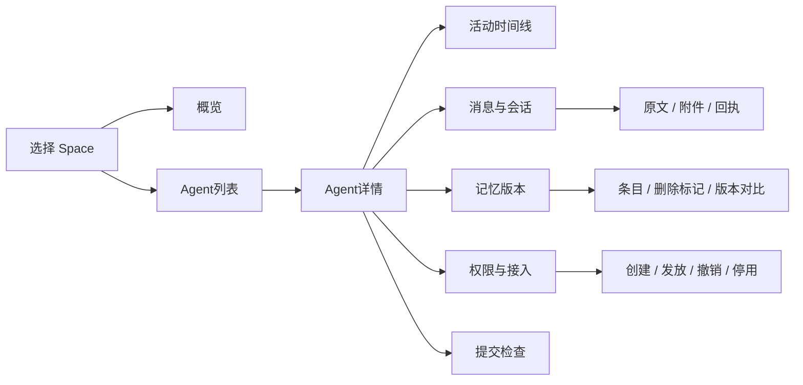

# RFC-0002：Waypost 管理 Dashboard 与内容检查

| 项目 | 值 |
|---|---|
| 状态 | Proposed / Step 2 配套提案 |
| 草案版本 | 0.1.0 |
| 日期 | 2026-10-12 |
| 基线 | [RFC-0001](0001-async-mailbox-and-memory-sync.md) |
| 实现范围 | 加入首版：实例所有者的 Dashboard、内容检查和已有控制面管理 |

## 1. 问题与目标

多个 Agent通过同一服务交换内容后，实例所有者需要一个可检查的入口：哪些身份已接入、发出了什么、同步了哪个记忆版本、哪些消费者已收取、哪些提交仍待恢复，以及每个凭据有哪些权限。

Dashboard为这些问题提供统一视图，并复用已有管理操作。它属于 Waypost项目，随开源服务提供。首版服务单个实例所有者；公开托管的多人账号、团队权限和计费另行设计。

## 2. 信息边界

首版展示服务已记录的事实：消息发布、记忆版本发布、回执推进、提交当前状态、身份与授权配置。界面逐项标注数据来源与阶段。

| 信息 | 首版依据 | 表达方式 |
|---|---|---|
| Agent最近活动 | 该 Actor已发布的 Feed及可查询提交 | 最近投递、同步、确认及时间 |
| 消息内容 | 不可变 Message和正文对象 | 原文、来源、附件、会话和收件范围 |
| 消费者进度 | Receipt与分视图 Checkpoint | received / processed与可靠保存位置 |
| 记忆内容 | 固定 Revision的完整条目与 Tombstone | 当前或历史版本、资料下载与结构差异 |
| 投递问题 | Submission的当前状态与固定错误 | reserved、prepared、committed、failed及可恢复标识 |
| 接入配置 | Actor、Consumer、token元数据和 grants | 身份、授权、期限与撤销状态 |

最近有活动不等于助手正在运行；没有新活动不等于离线。processed是消费者的声明，不能在界面中改称外部任务已成功执行。

外部助手内部的工具调用或执行轨迹需要显式上报协议、来源标注及用户授权。首版按服务已有事实实现；主动运行轨迹上报列为独立扩展，后续明确范围再实施。界面不伪造未上报的行为。

## 3. 页面与操作

### 3.1 概览

- 当前 Space的 Agent、Consumer和 Collection数量。
- 最近已发布活动，明确展示生产者、类型与服务时间。
- reserved/prepared提交数量与最早等待时间。
- failed提交的错误概览，进入检查详情。

统计直接查询关系数据，首版不引入独立指标平台或缓存计数。界面使用有界分页与手动刷新，可添加有限轮询；核心数据不依赖浏览器持续在线。

### 3.2 Agent列表与详情

Actor.kind为 agent的参与者在 Agent列表展示；用户和客户端身份也可切换查看。身份可来自任意兼容 MCP/HTTP宿主，显示名称不能代替 actor_id。

详情包括：固定身份、当前权限、最近活动、生产与收到的消息、Consumer独立进度、来源 Collection、提交状态。筛选按 Space、Actor、类型、会话和状态，列表每次最多100项，默认50项。

### 3.3 内容 Inspector

消息详情展示不可变身份、原正文、来源引用、会话关系、收件人、附件和各 Consumer真实回执。资料通过同源受保护下载接口读取，不把对象存储管理地址或永久公开 URL放进界面。

记忆 Inspector明确选中 revision，后续分页保持该版本。支持查看 Tombstone，并比较两个版本的新增、修改、删除和恢复。对比以结构化条目为依据，首版不做语义总结或自动合并。

正文与 metadata均视为外部内容。文本、Markdown和下载名称采用安全的显示与编码；网页不执行其中的脚本、工具命令或权限声明。

### 3.4 管理

复用 RFC-0001的控制面：创建 Space、Actor、Consumer、Collection、发放受限 token、撤销 token、停用 Actor，并提供已明确的会话成员授权。

token原文只在生成成功时显示一次。后续列表只显示 token_id、所属身份、scope、资源授权、期限与撤销状态。权限变更通过发放新凭据与撤销旧凭据完成，原始身份和既有提交不改变。

停用和撤销页面展示实际影响：新调用和发布会被拒绝，已发布内容与历史版本仍保留。界面不提供删除历史、强行推进消费者回执或清空记忆的隐含快捷操作。

## 4. 领域与接口边界

Dashboard是管理视图，不新增 Agent运行时聚合。它使用独立的 InstanceAdminPrincipal；普通数据面 token不能进入 Dashboard管理接口。

管理员能检查其管理实例内的 Space数据，包括消息、来源记忆和提交。此权能是明确的实例所有者管理能力，不由普通 space.observe自动推导。多所有者托管之前需另行定义管理读取权限。

新增管理读取接口位于 `/admin/v0`，与 RFC-0001创建与撤销接口共享认证边界。

| HTTP接口 | 结果 |
|---|---|
| GET /spaces | 实例所有者管理的空间列表 |
| GET /spaces/{space_id}/overview | 基于当前关系状态的有界概览 |
| GET /spaces/{space_id}/actors | 身份列表，按 kind筛选 |
| GET /spaces/{space_id}/actors/{actor_id} | 身份详情及授权摘要 |
| POST /spaces/{space_id}/activity/read | 按发布序号分页的服务事实 |
| GET /spaces/{space_id}/messages | 消息索引；支持生产者、收件人与会话筛选 |
| GET /spaces/{space_id}/messages/{message_id} | 原文、附件引用及回执摘要 |
| GET /spaces/{space_id}/consumers | Consumer及固定视图 |
| GET /spaces/{space_id}/tokens | 凭据元数据及 grants，排除原 token |
| GET /spaces/{space_id}/submissions | 提交列表，支持 Actor、operation与状态筛选 |
| GET /spaces/{space_id}/submissions/{submission_id} | 预留身份、准备与当前结果，不包含凭据 |
| GET /spaces/{space_id}/collections | 来源 Collection列表 |
| GET /spaces/{space_id}/collections/{collection_id}/revisions | 历史版本列表 |
| POST /spaces/{space_id}/collections/{collection_id}/read | 固定版本条目页 |
| POST /spaces/{space_id}/collections/{collection_id}/compare | 两个固定版本之间的分页结构差异 |
| GET /spaces/{space_id}/blobs/{blob_id} | 管理员获准的封存内容下载 |

以上路径在表中省略共同 `/admin/v0`前缀。管理分页游标绑定管理员会话/授权代次、Space、接口和固定过滤条件，不借用某个普通 Consumer的游标，也不推进其检查点。

MetadataStore的管理读取扩展提供 list_actors、read_actor、read_activity、read_submission、list_collections、read_revision和compare_revisions等具名操作。结果是明确的 Rust结构；首版不把任意 SQL或整份数据库下载暴露给浏览器。

## 5. Dashboard登录与会话

现有 CLI仍可使用独立管理员 Bearer凭据。浏览器使用短期管理会话：

1. 管理员通过同源登录页提交 WAYPOST_ADMIN_SECRET。
2. 服务校验后生成至少32随机字节的 session凭据，只保存其摘要。
3. 浏览器通过 HttpOnly、生产环境 Secure、SameSite=Strict的 Cookie使用会话。
4. 写操作检查可信同源 Origin、JSON请求类型与当前有效会话；普通 Agent Bearer不能替代管理身份。
5. 退出撤销当前会话；会话到期或管理员 secret轮换后失效。

原管理员 secret不存入浏览器 localStorage、项目配置导出或数据库。生产实例通过 HTTPS使用；本机 HTTP仅用于绑定 loopback的开发方式，并明确采用开发 Cookie配置。

新增 `admin_sessions`关系表：session_id、session_digest、admin_secret_fingerprint、created_at、expires_at、revoked_at。默认会话期限8小时，后台不无限续期。凭据轮换后的当前指纹检查在每次管理请求执行，旧会话不能继续操作。

管理操作按已有幂等契约处理超时，界面不能为同一次创建随意换 request_id。服务返回的错误沿用 RFC-0001领域码；登录和会话错误使用 UNAUTHENTICATED。

## 6. 部署与结构

静态 Dashboard资源位于项目的 `dashboard/`，由同一个服务提供，使用同源管理接口。Rust负责服务与领域逻辑；前端采用可静态部署的 HTML/CSS/JavaScript，具体框架在实现前确定。

Cloudflare部署复用 Workers、D1、R2。自托管部署复用原生 Rust服务、SQLite和文件对象存储。Dashboard读写不改变 MCP工具、普通 token授权或原消息协议。

UI资产进入开源仓库。首版无第三方分析脚本，无外部 Agent凭据收集，也不依赖某个商业客户端才能管理。

## 7. 验证契约提案

这些条目将在 Step 3细化并确认：

| 性质 | 观察边界 |
|---|---|
| 普通 Agent凭据无法读取管理内容或调用控制面 | 真实管理 HTTP接口 |
| Cookie会话到期、退出及管理员 secret轮换后失效 | 登录、退出和受保护管理接口 |
| 任意 Space/Actor筛选返回正确的服务事实 | 管理读取与相同已发布数据 |
| 回执展示不把 committed、received、processed混为外部任务结果 | 页面状态与公开接口结果 |
| 版本对比及分页不混入后来更新的 head | 两个明确 revision的 Inspector接口 |
| 管理查看不推进 Consumer检查点或产生 ACK | 管理查看前后的公开 Consumer状态 |
| token列表、HTML、日志和下载不包含原凭据 | 公开输出与一次性发放流程 |
| 外部正文无法在 Inspector中执行脚本或改变权限 | 浏览器交互测试和控制面状态 |
| 页面创建操作在响应丢失后重试不重复创建 | 同管理 request_id的 HTTP重试 |

管理接口的契约测试使用真实 SQLite与存储适配；核心消息性质仍由 RFC-0001的 P01–P18验证。

## 8. 实现阶段与待确认选择

Dashboard加入首版交付，与核心服务分切片实现：先管理读取接口，再基础页面与 Inspector，再凭据和身份管理闭环。正式宣称可用前完成管理认证与真实页面交互验证。

主动上报 Agent工具调用/运行记录作为独立扩展。若后续加入，需要明确数据结构、幂等事件身份、来源说明、内容上限和授权契约；原有持久 Feed与消费进度不会被上报日志替代。
